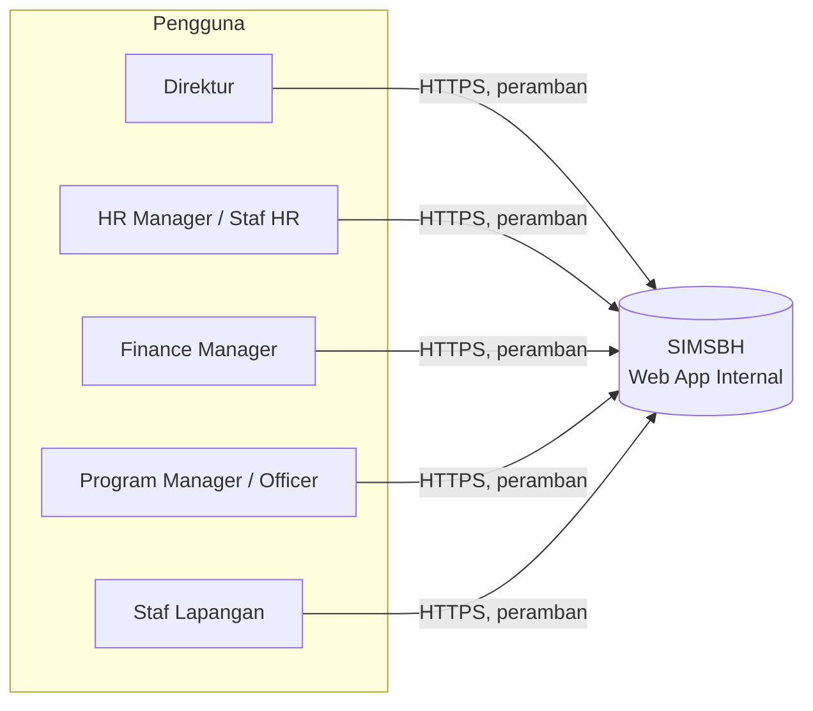
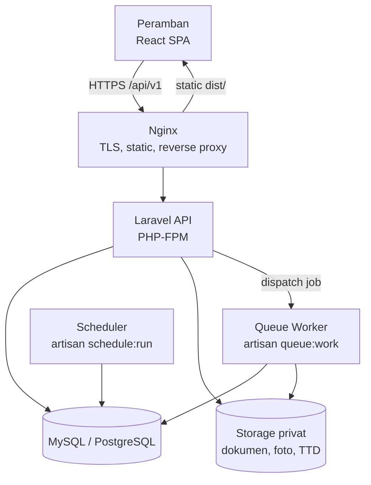
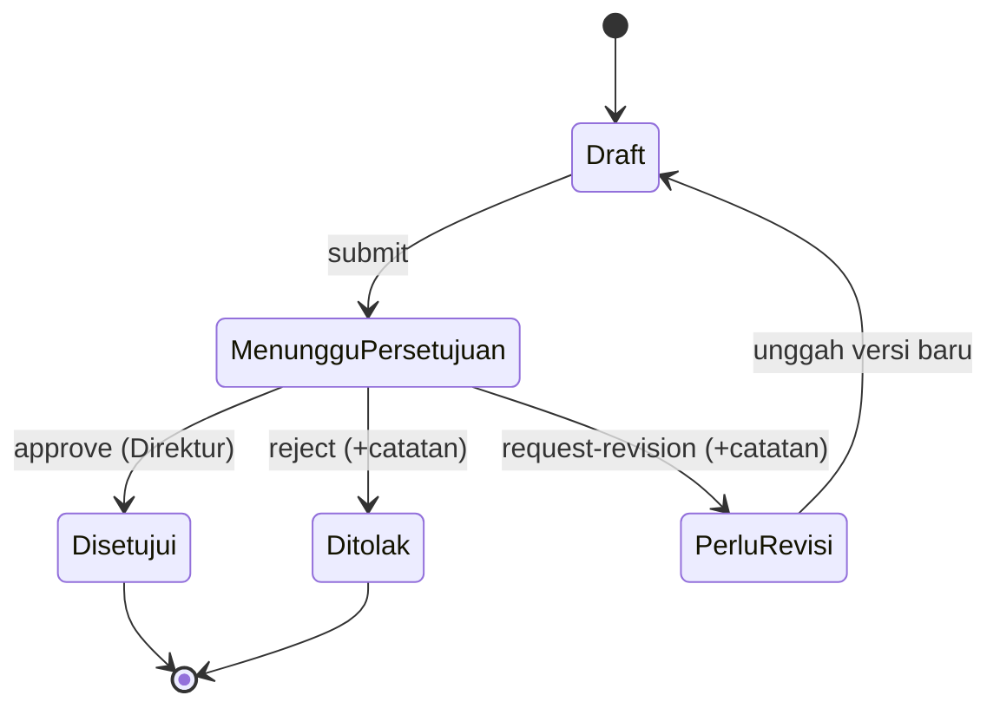
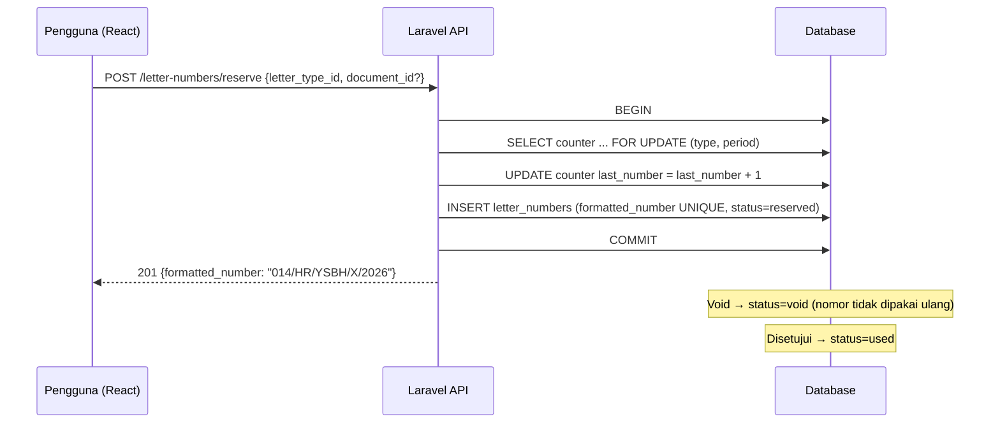

# ARCHITECTURE.md

## SIMSBH: Sistem Informasi Terintegrasi Yayasan Sinar Bhakti Husada

| Item | Keterangan |
| --- | --- |
| Dokumen | Arsitektur Sistem (Software Architecture Document) |
| Versi | 1.0 (Draft) |
| Tanggal | 16 Oktober 2026 |
| Pasangan dokumen | `PRD_SIM_Yayasan_Sinar_Bhakti_Husada.md`, `DESIGN.md` |
| Stack | Laravel (REST API) · React + Vite + TypeScript · shadcn/ui · MySQL/PostgreSQL |

> Tanda **[ASUMSI]** berarti keputusan belum tertulis di proposal/PRD dan perlu dikonfirmasi saat validasi kebutuhan.

---

## 1. Konteks dan Tujuan Arsitektur

Yayasan Sinar Bhakti Husada bergerak di bidang kesehatan (eliminasi malaria di Papua). Sistem internal ini memusatkan dokumen HR, Keuangan, Program, persetujuan Direktur, penomoran surat, absensi, dan logbook.

### 1.1 Driver Arsitektur

| Driver | Konsekuensi arsitektural |
| --- | --- |
| Skala kecil (puluhan pengguna internal) | **Modular monolith**, bukan microservices. Satu API, satu database, satu deployment |
| Dikembangkan satu orang dalam ±4 bulan | Konvensi framework (Laravel, shadcn), minim komponen bergerak, otomasi pengujian pada area kritis |
| Nomor surat tidak boleh ganda | Transaksi DB + row lock + unique constraint (lihat 7.2) |
| HR tidak boleh melihat gaji | Otorisasi server-side (Policy) dan pemisahan Resource/endpoint (lihat 6) |
| Jejak persetujuan wajib ada | Versioning dokumen, state machine, audit log *append-only* |
| Staf Lapangan di Papua, jaringan lemah | Payload kecil, kompresi gambar di klien, unggah dengan progres dan retry |
| Data kesehatan/pasien tidak disimpan | Tidak ada field terkait pasien; peringatan di form unggah bukti |

### 1.2 Prinsip

1. **Server adalah sumber kebenaran.** Frontend hanya menyembunyikan UI; keputusan izin ada di backend.
2. **Sederhana dulu.** Tidak ada Redis, Kubernetes, atau message broker kecuali terbukti perlu.
3. **Konfigurasi, bukan hard-code.** Format nomor surat, jam kerja, batas unggah diatur lewat tabel/konfigurasi.
4. **Semua perubahan penting dapat ditelusuri.**
5. **Satu cara untuk satu hal.** Satu pola controller → service → model; satu pola data fetching di frontend.

---

## 2. Gambaran Sistem (C4 Level 1–2)

### 2.1 Konteks



Tidak ada integrasi sistem eksternal (di luar ruang lingkup TA).

### 2.2 Kontainer



| Kontainer | Tanggung jawab |
| --- | --- |
| React SPA | Presentasi, routing, validasi form sisi klien, cache data (TanStack Query) |
| Nginx | TLS, melayani build statis, meneruskan `/api` ke PHP-FPM, batas ukuran unggah |
| Laravel API | Autentikasi, otorisasi, aturan bisnis, akses data, audit |
| Queue worker | Notifikasi, pemrosesan thumbnail, pembersihan berkas sementara |
| Scheduler | Penanda logbook belum terisi, pengingat kontrak berakhir, pembersihan |
| Database | Data transaksional, counter nomor surat, audit log |
| Storage privat | Berkas di luar `public/`; diunduh lewat endpoint terotorisasi |

---

## 3. Keputusan Arsitektur (ADR Ringkas)

| ID | Keputusan | Alternatif | Alasan |
| --- | --- | --- | --- |
| ADR-01 | Modular monolith | Microservices | Tim 1 orang, skala kecil, transaksi lintas modul (dokumen ↔ nomor surat ↔ approval) lebih mudah dalam satu DB |
| ADR-02 | SPA React + REST API terpisah | Inertia/Blade | Sesuai proposal (React + Laravel), pemisahan jelas, mudah diuji |
| ADR-03 | Laravel Sanctum (mode SPA, cookie session) | JWT | Lebih aman terhadap XSS pencurian token, bawaan Laravel, satu domain induk |
| ADR-04 | `spatie/laravel-permission` + Laravel Policy **[ASUMSI]** | Gate manual | Role/permission siap pakai; Policy untuk aturan per-record |
| ADR-05 | Reservasi nomor surat via `lockForUpdate` + unique index | Auto-increment, lock aplikasi | Aman terhadap konkurensi, bisa diuji, portabel di MySQL/PostgreSQL |
| ADR-06 | Versioning dokumen eksplisit (`document_versions`) | Menimpa berkas | Menjawab masalah versi ganda dan riwayat |
| ADR-07 | Disk storage privat + endpoint unduh | URL publik/S3 publik | Dokumen internal sensitif |
| ADR-08 | shadcn/ui + Tailwind | MUI, Ant Design | Komponen dimiliki di repo, mudah dikustomisasi ke tema hijau yayasan, aksesibel (Radix) |
| ADR-09 | TanStack Query untuk data server | Redux | Cache, refetch, invalidasi sesuai kebutuhan CRUD |
| ADR-10 | Queue driver `database` | Redis | Cukup untuk beban kecil, nol dependensi tambahan |
| ADR-11 | Waktu disimpan UTC, ditampilkan Asia/Jayapura (WIT) **[ASUMSI]** | Waktu lokal di DB | Menghindari bug zona waktu; absensi memakai jam server |

---

## 4. Struktur Repositori (Monorepo)

```
simsbh/
├── backend/                         # Laravel 11/12, PHP 8.3
│   ├── app/
│   │   ├── Enums/                   # DocumentStatus, LetterNumberStatus, RoleName, Department
│   │   ├── Http/
│   │   │   ├── Controllers/Api/V1/  # tipis: validasi → service → resource
│   │   │   ├── Middleware/
│   │   │   ├── Requests/            # Form Request (validasi + authorize)
│   │   │   └── Resources/           # API Resource (kontrol field yang keluar)
│   │   ├── Models/
│   │   ├── Policies/
│   │   ├── Services/                # logika bisnis per domain
│   │   │   ├── Approval/ApprovalService.php
│   │   │   ├── Document/DocumentService.php
│   │   │   ├── Letter/LetterNumberService.php
│   │   │   ├── Attendance/AttendanceService.php
│   │   │   └── Audit/AuditLogger.php
│   │   ├── Notifications/
│   │   ├── Jobs/
│   │   └── Observers/               # audit otomatis pada model sensitif
│   ├── config/simsbh.php            # jam kerja, batas unggah, zona waktu, dsb.
│   ├── database/{migrations,seeders,factories}/
│   ├── routes/api.php
│   └── tests/{Feature,Unit}/
├── frontend/                        # React + Vite + TypeScript
│   ├── components.json              # konfigurasi shadcn
│   └── src/
│       ├── app/                     # providers, router, layout root
│       ├── components/
│       │   ├── ui/                  # komponen shadcn (hasil CLI)
│       │   └── shared/              # komponen domain: StatusBadge, DataTable, FileUploader, ...
│       ├── features/<modul>/        # api.ts, hooks.ts, schemas.ts, pages/, components/
│       ├── lib/                     # api-client, permissions, format, utils
│       ├── hooks/
│       ├── styles/globals.css       # token tema hijau
│       └── types/
├── deploy/                          # docker-compose, nginx.conf, env.example
├── docs/                            # PRD, ARCHITECTURE, DESIGN, ERD, OpenAPI
└── .github/workflows/ci.yml
```

---

## 5. Arsitektur Backend (Laravel)

### 5.1 Pola Berlapis

```
HTTP Request
   │
   ▼
Middleware (auth:sanctum, throttle, active-user)
   │
   ▼
FormRequest  ── validasi input + authorize() lewat Policy
   │
   ▼
Controller (tipis)  ──►  Service (aturan bisnis, transaksi)  ──►  Model/Eloquent
   │                              │
   │                              ├─► AuditLogger
   │                              └─► Event / Notification (queue)
   ▼
API Resource  ── bentuk JSON final (hanya field yang boleh dilihat peran)
```

Aturan: controller tidak berisi logika bisnis; service tidak mengenal `Request`/`Response`; model tidak memanggil service.

### 5.2 Modul Domain

| Modul | Model utama | Service | Policy |
| --- | --- | --- | --- |
| Auth & User | User, Role | AuthService | UserPolicy |
| HR | Employee, Contract | EmployeeService, ContractService | EmployeePolicy, ContractPolicy |
| Keuangan | Salary, Budget, BudgetItem, AccountabilityReport | PayrollService, BudgetService | **SalaryPolicy**, BudgetPolicy |
| Program | Activity, ActivityAssignment, ActivityEvidence | ActivityService, EvidenceService | ActivityPolicy, EvidencePolicy |
| Absensi & Logbook | Attendance, Logbook | AttendanceService, LogbookService | AttendancePolicy |
| Dokumen | Document, DocumentVersion, DocumentApproval, DocumentHistory | DocumentService, **ApprovalService** | DocumentPolicy |
| Nomor Surat | LetterType, LetterCounter, LetterNumber | **LetterNumberService** | LetterNumberPolicy |
| Audit | AuditLog | AuditLogger | AuditLogPolicy |
| Dashboard | (query agregat) | DashboardService | – |

### 5.3 Autentikasi

- **Sanctum SPA mode**: cookie sesi `HttpOnly` + CSRF token (`/sanctum/csrf-cookie`).
- Frontend dan API berada pada domain induk yang sama (mis. `app.sinarbhakti.example` dan `/api`) **[ASUMSI]**.
- Akun dibuat HR Manager; tidak ada registrasi publik.
- Pengguna `is_active = false` ditolak di middleware `EnsureUserIsActive`.
- Rate limit login (mis. 5/menit per email+IP), kunci sementara setelah gagal berulang.

### 5.4 Otorisasi (RBAC)

Dua lapis:

1. **Role/permission** (Spatie): izin kasar, contoh `salary.view`, `document.approve`, `letter.reserve`.
2. **Policy per-record**: izin kontekstual, contoh "Staf Lapangan hanya menghapus bukti miliknya yang belum diverifikasi".

```php
// SalaryPolicy.php: HR TIDAK PERNAH lolos, apa pun permission-nya
public function viewAny(User $user): bool
{
    return $user->hasAnyRole([RoleName::FINANCE_MANAGER, RoleName::DIRECTOR]);
}
```

Jaminan **HR tidak mengakses gaji** berlapis:
1. Route `/salaries*` dilindungi `can:viewAny,App\Models\Salary`.
2. `EmployeeResource` **tidak pernah** memuat relasi `salaries` (resource terpisah `EmployeeWithSalaryResource` hanya untuk Keuangan/Direktur).
3. Global scope/query tidak melakukan `with('salaries')` pada endpoint HR.
4. Feature test memastikan HR Manager/Staf HR menerima 403 pada seluruh endpoint gaji dan respons karyawan tidak mengandung field gaji.
5. Setiap pembacaan gaji dicatat di audit log.

### 5.5 Konvensi API

- Prefiks `/api/v1`, JSON, nama resource jamak berbahasa Inggris (`/employees`, `/documents`), label UI berbahasa Indonesia di frontend.
- Respons sukses:

```json
{
  "data": { },
  "meta": { "current_page": 1, "per_page": 15, "total": 120 },
  "message": "OK"
}
```

- Respons error (validasi 422, otorisasi 403, tidak ditemukan 404, konflik 409):

```json
{
  "message": "Data tidak valid.",
  "errors": { "title": ["Judul wajib diisi."] },
  "code": "VALIDATION_ERROR"
}
```

- Paginasi, `?sort=-created_at`, `?filter[status]=approved`, `?search=` di sisi server.
- Dokumentasi OpenAPI dibuat otomatis (Scribe atau Scramble).

---

## 6. Alur Kritis

### 6.1 Siklus Dokumen dan Persetujuan



Implementasi di `ApprovalService`:
- Matriks transisi yang diizinkan didefinisikan di `DocumentStatus` (enum); transisi lain → 422.
- Setiap transisi dalam **satu transaksi** yang: memperbarui status, menulis `document_approvals`, menulis `document_histories`, memperbarui status nomor surat (lihat 6.2), memicu notifikasi.
- Saat `MenungguPersetujuan` dan `Disetujui`, pembaruan isi/versi diblokir (BR-02, BR-03).
- Urutan penulisan: validasi izin → kunci baris dokumen (`lockForUpdate`) → periksa status → ubah → catat → commit → dispatch notifikasi *after commit*.

### 6.2 Penomoran Surat (Anti-Duplikasi)



Jaminan:
- `SELECT … FOR UPDATE` menserialkan permintaan paralel pada counter yang sama.
- `UNIQUE(formatted_number)` dan `UNIQUE(letter_type_id, period_key, sequence)` sebagai **jaring pengaman terakhir** bila ada bug logika.
- Nomor dialokasikan saat draf dibuat (BR-06), sehingga karyawan lain melihat nomor yang tengah menunggu di register dan tidak perlu menebak.
- Pengujian: test konkurensi (≥ 100 proses/permintaan paralel) harus menghasilkan nol duplikat dan urutan tanpa celah, kecuali `void`.

Format nomor di-render oleh `LetterNumberFormatter` dari pola di `letter_types` (contoh **[ASUMSI]**: `{urut:3}/{kode}/YSBH/{bulan_romawi}/{tahun}`).

### 6.3 Unggah Berkas (Dokumen dan Bukti Lapangan)

1. Klien mengompresi gambar (maks sisi panjang ±1920 px, kualitas ±0,8) sebelum unggah.
2. `POST multipart` dengan progres (Axios `onUploadProgress`), retry manual jika gagal.
3. Backend memvalidasi **MIME sebenarnya** (bukan hanya ekstensi), ukuran (**[ASUMSI]** ≤ 10 MB), menyanitasi nama, menyimpan sebagai `storage/app/private/{kategori}/{yyyy}/{mm}/{uuid}.{ext}`.
4. Unduh via `GET /documents/{id}/download`: dicek Policy, lalu `Storage::download()` / *streamed response*.
5. Tidak ada tautan publik permanen.

### 6.4 Absensi

- Waktu check-in/out selalu `now()` server (BR-08).
- `UNIQUE(employee_id, date)`; check-in kedua pada hari yang sama → 409.
- Tanggal "hari ini" dihitung berdasarkan zona waktu yayasan (`config('simsbh.timezone')`).
- Scheduler harian menandai karyawan yang belum mengisi absensi/logbook untuk panel kepatuhan Direktur.

### 6.5 Audit Log

- `AuditLogger::record(action, subject, old, new)` dipanggil dari service dan `Observer` pada model sensitif (Salary, Contract, Employee, Document, LetterNumber).
- Tabel `audit_logs` *append-only*: tidak ada route update/delete; di level DB dapat diberi izin INSERT/SELECT saja untuk user aplikasi **[ASUMSI]**.
- Mencatat: user, aksi, objek, nilai lama/baru (data sensitif dimask bila perlu), IP, user agent, waktu.

---

## 7. Arsitektur Frontend (React)

### 7.1 Tumpukan

| Kebutuhan | Pilihan |
| --- | --- |
| Build | Vite + TypeScript (strict) |
| Routing | React Router (data router, route per peran) |
| Server state | TanStack Query |
| Form | React Hook Form + Zod (via `@hookform/resolvers`) |
| HTTP | Axios (instance tunggal, `withCredentials`, interceptor 401/403/422) |
| UI | **shadcn/ui** (Radix + Tailwind) dengan tema hijau (lihat `DESIGN.md`) |
| Ikon | lucide-react |
| Tabel | TanStack Table di balik komponen `DataTable` shadcn |
| Tanggal | date-fns (locale `id`) |
| Notifikasi UI | Sonner (toast) |
| Grafik | Recharts (via komponen `chart` shadcn) |
| Pengujian | Vitest + Testing Library, MSW untuk mock API |

### 7.2 Layering

```
pages/            ← komposisi layar, ambil data lewat hooks
  └─ features/<modul>/hooks.ts     ← useQuery/useMutation (TanStack Query)
        └─ features/<modul>/api.ts ← fungsi pemanggil endpoint (typed)
              └─ lib/api-client.ts ← Axios instance
components/shared/ ← komponen domain reusable (StatusBadge, ApprovalTimeline, ...)
components/ui/     ← primitif shadcn (jangan berisi logika domain)
```

Konvensi query key: `['documents', 'list', filters]`, `['documents', 'detail', id]`. Mutasi menginvalidasi key terkait (mis. approve → `['documents']`, `['approvals','pending']`, `['dashboard']`).

### 7.3 Routing dan Guard Peran

```tsx
// lib/permissions.ts
export const can = (user: AuthUser, permission: Permission) =>
  user.permissions.includes(permission);

// ProtectedRoute: pastikan login + (opsional) permission
<Route element={<ProtectedRoute />}>
  <Route element={<AppShell />}>
    <Route index element={<DashboardRouter />} />   {/* pilih dashboard per peran */}
    <Route element={<RequirePermission perm="document.approve" />}>
      <Route path="approvals" element={<ApprovalQueuePage />} />
    </Route>
    <Route element={<RequirePermission perm="salary.view" />}>
      <Route path="payroll" element={<PayrollPage />} />
    </Route>
  </Route>
</Route>
```

- Daftar permission datang dari `GET /auth/me` (satu sumber dengan backend).
- Menu sidebar dibangun dari konfigurasi navigasi yang difilter dengan `can()`.
- **Menyembunyikan UI bukan keamanan**: backend tetap menolak dengan 403, dan frontend menampilkan halaman "Akses ditolak".

### 7.4 Penanganan Error dan State

| Kondisi | Perilaku UI |
| --- | --- |
| 401 | Bersihkan sesi, redirect ke login dengan pesan "Sesi berakhir" |
| 403 | Halaman/Alert "Anda tidak memiliki akses" |
| 422 | Petakan `errors` ke field form (`setError`) |
| 409 | Toast informatif (mis. sudah check-in) |
| 5xx/jaringan | Toast + tombol Coba Lagi; unggah dapat diulang |
| Loading | `Skeleton`; tombol submit `disabled` + spinner |
| Kosong | Komponen `EmptyState` dengan ajakan tindakan |

### 7.5 Performa dan Jaringan Lemah

- Code splitting per rute (`React.lazy`), hanya muat modul yang diperlukan peran.
- Paginasi server-side; `staleTime` wajar agar tidak refetch berlebihan.
- Kompresi gambar sebelum unggah; indikator progres; jangan memblokir seluruh UI saat unggah.
- Aset statis di-cache oleh Nginx (hash pada nama file Vite).

---

## 8. Model Data

Rincian tabel ada di PRD bagian 10. Prinsip implementasi:

- Semua tabel memakai `id` (bigint atau ULID **[ASUMSI]**), `created_at`, `updated_at`; *soft delete* hanya untuk karyawan, kontrak, dan dokumen non-final.
- Foreign key dengan `ON DELETE RESTRICT` pada relasi riwayat; tidak ada penghapusan yang merusak jejak.
- Indeks: `attendances(employee_id, date)` unik, `logbooks(employee_id, date)` unik, `documents(status, department)`, `letter_numbers(formatted_number)` unik, `letter_counters(letter_type_id, period_key)` unik, `audit_logs(auditable_type, auditable_id)`.
- Uang disimpan sebagai `DECIMAL(15,2)`, bukan float.
- Enum didefinisikan di PHP (`Enum`) dan dipetakan ke kolom string, bukan enum DB, agar migrasi mudah.

---

## 9. Keamanan

| Area | Kontrol |
| --- | --- |
| Transport | HTTPS wajib, HSTS |
| Sesi | Cookie `HttpOnly`, `Secure`, `SameSite=Lax`, rotasi sesi saat login |
| Password | Bcrypt/Argon2, kebijakan panjang minimum, ganti password |
| CSRF | Token Sanctum + `X-XSRF-TOKEN` |
| XSS | React meng-escape secara default; larang `dangerouslySetInnerHTML`; CSP dasar |
| SQL injection | Eloquent/query binding saja; tanpa query mentah dari input |
| Unggah berkas | Validasi MIME, ukuran, nama acak, disk privat, tanpa eksekusi |
| Akses | Policy di tiap endpoint; Resource per peran; uji matriks akses otomatis |
| Rate limiting | Login dan unggah |
| Rahasia | `.env` di luar repo; kunci aplikasi unik per lingkungan |
| Privasi | Tidak menyimpan data pasien; data gaji terisolasi; audit akses data sensitif |
| Backup | Dump DB dan sinkron storage terjadwal harian **[ASUMSI]**, uji restore berkala |

---

## 10. Deployment

### 10.1 Topologi

```
[Internet/VPN] ──► Nginx (TLS) ──┬─► /           → frontend/dist (statis)
                                 └─► /api, /sanctum → PHP-FPM (Laravel)
                                                    ├─ MySQL/PostgreSQL
                                                    ├─ storage/app/private
                                                    ├─ queue:work (supervisor)
                                                    └─ cron: schedule:run
```

Hosting **[ASUMSI]**: satu VPS (2 vCPU / 4 GB RAM cukup untuk skala ini) atau server yayasan. Alternatif: Docker Compose (`nginx`, `app`, `db`, `queue`, `scheduler`).

### 10.2 Lingkungan

| Lingkungan | Tujuan | Catatan |
| --- | --- | --- |
| Local | Pengembangan | Docker Compose / `php artisan serve` + `npm run dev` |
| Staging | UAT dengan pengguna yayasan | Data dummy/anonim |
| Production | Operasional | Backup, monitoring dasar |

### 10.3 Variabel Lingkungan Penting

```
APP_ENV, APP_KEY, APP_URL, FRONTEND_URL
DB_CONNECTION, DB_HOST, DB_DATABASE, DB_USERNAME, DB_PASSWORD
SESSION_DOMAIN, SANCTUM_STATEFUL_DOMAINS
FILESYSTEM_DISK=private
QUEUE_CONNECTION=database
APP_TIMEZONE=UTC            # tampilan WIT diatur di config/simsbh.php
MAX_UPLOAD_MB=10
```

---

## 11. Observabilitas dan Operasional

- Log aplikasi terstruktur (Laravel log channel `daily`), level `warning` di produksi.
- Halaman/endpoint `GET /health` (DB, storage, queue).
- Pantau: kegagalan job, ruang disk storage, waktu respons dasar.
- Prosedur: runbook singkat (deploy, rollback, restore backup, reset password admin).

---

## 12. Strategi Pengujian

| Lapisan | Alat | Fokus |
| --- | --- | --- |
| Unit (backend) | Pest/PHPUnit | `LetterNumberFormatter`, transisi `DocumentStatus`, perhitungan RAB |
| Feature (backend) | Pest/PHPUnit + `RefreshDatabase` | Semua endpoint, **matriks peran × aksi**, HR ↛ gaji, alur approval |
| Konkurensi | Skrip paralel / pengujian proses | Nomor surat: 0 duplikat |
| Frontend unit/komponen | Vitest + Testing Library + MSW | Form, guard peran, StatusBadge |
| E2E (opsional) | Playwright | Alur: login → ajukan dokumen → Direktur setujui |
| Black-box & UAT | Test case terdokumentasi | Sesuai Bab III proposal |
| Usability | SUS + task-based | Sesuai Bab III proposal |

CI (GitHub Actions): `pint` + `phpstan/larastan`, `pest`, `eslint`, `tsc --noEmit`, `vitest`, build frontend.

---

## 13. Pemetaan Kebutuhan ke Komponen Arsitektur

| Kebutuhan (PRD) | Komponen |
| --- | --- |
| FR-AUTH, FR-HR-07, FR-FIN-02, BR-01 | Sanctum, Spatie, Policy, Resource terpisah, uji akses |
| FR-DOC (versi, status, riwayat, persetujuan) | `DocumentService`, `ApprovalService`, `document_versions`, `document_histories` |
| FR-SRT, BR-05, BR-06 | `LetterNumberService`, `letter_counters`, unique index |
| FR-ATT, FR-LOG | `AttendanceService`, scheduler kepatuhan, waktu server |
| FR-EVD, NFR-07 | `FileUploader` (kompresi + progres), storage privat |
| FR-DSH | `DashboardService` (query agregat), halaman dashboard per peran |
| FR-AUD | `AuditLogger`, `Observer`, tabel append-only |
| NFR-04, NFR-05 | shadcn/ui, tema hijau, desain responsif (`DESIGN.md`) |

---

## 14. Risiko Arsitektural

| Risiko | Mitigasi |
| --- | --- |
| Kebocoran data gaji lewat Resource/relasi | Resource terpisah, uji respons, audit |
| Race condition nomor surat | Row lock + unique constraint + uji konkurensi |
| Cakupan membesar | Pegang MoSCoW; modul *Could* ditunda |
| Server tunggal sebagai titik gagal | Backup harian terjadwal, runbook restore |
| Ketergantungan versi library (shadcn, Tailwind v4) | Kunci versi di `package.json`/lockfile, perbarui terencana |
