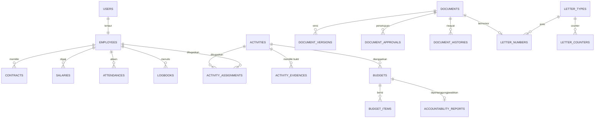

# Product Requirements Document (PRD)

## Sistem Informasi Terintegrasi Berbasis Web untuk Pengelolaan Internal Yayasan Sinar Bhakti Husada

| Item | Keterangan |
| --- | --- |
| Nama Produk | SIM Terintegrasi Yayasan Sinar Bhakti Husada (kode kerja: **SIMSBH**) |
| Pemilik Produk | I Kadek Hermanta (Direktur) |
| Pengembang | Vinsensius Devando Febrilian (230712320) |
| Dosen Pembimbing | Theresia Devi Indriasari, S.T., M.Sc., Ph.D. |
| Versi | 1.0 (Draft) |
| Tanggal | 16 Oktober 2026 |
| Stack | **Backend:** Laravel (REST API) · **Frontend:** React (SPA) · **DB:** MySQL/PostgreSQL |
| Sumber | Proposal Tugas Akhir V2 (Revisi Terbaru) |

> **Catatan penggunaan.** Hal-hal yang tidak tertulis eksplisit di proposal ditandai **[ASUMSI]** dan harus divalidasi bersama Direktur/HR/Keuangan/Program pada tahap Analisis dan Validasi Kebutuhan (Bulan 1).

---

## 1. Ringkasan Eksekutif

Yayasan Sinar Bhakti Husada (program penanggulangan dan eliminasi malaria di Papua) mengelola dokumen HR, Keuangan, dan Program secara manual lewat Excel, Word, WhatsApp, dan Google Drive. Akibatnya dokumen beredar dalam banyak versi, riwayat perubahan/persetujuan sulit dilacak, nomor surat berpotensi duplikat, dan Direktur harus memantau absensi serta logbook secara manual.

SIMSBH adalah aplikasi web internal yang memusatkan data dan dokumen tiga bagian (HR, Keuangan, Program) dalam satu alur kerja dengan persetujuan Direktur, penomoran surat otomatis tanpa duplikasi, serta pemantauan absensi dan logbook.

## 2. Latar Belakang dan Masalah

| # | Masalah saat ini | Dampak | Solusi di sistem |
| --- | --- | --- | --- |
| P1 | Dokumen dikirim bolak-balik via WhatsApp, tidak ada sumber data tunggal | Banyak versi, sulit memastikan versi terbaru | Repositori dokumen terpusat + versioning |
| P2 | Perubahan dan persetujuan terpendam di chat | Tidak ada jejak audit | Riwayat versi, status, dan log persetujuan |
| P3 | Dokumen terlewat/terlambat karena pengiriman manual | Proses tertunda | Alur kerja berstatus + notifikasi + antrean persetujuan |
| P4 | Nomor surat dicatat setelah disetujui; karyawan menebak nomor | Nomor ganda, arsip kacau | Register nomor surat terpusat dengan reservasi atomik |
| P5 | Direktur memantau absensi/logbook lewat Google Drive dan mengumpulkan info per bagian | Tidak ada gambaran menyeluruh | Modul absensi/logbook + dashboard Direktur |
| P6 | Bukti kegiatan Staf Lapangan dikirim terpisah ke Program dan Keuangan | Bukti tercecer | Unggah sekali, tertaut ke kegiatan, terlihat oleh Program dan Keuangan |

## 3. Tujuan, Pertanyaan Penelitian, dan Metrik Keberhasilan

| ID | Tujuan (dari proposal) | Metrik/Kriteria Keberhasilan | Bukti |
| --- | --- | --- | --- |
| G1 | Membangun sistem web terintegrasi yang mendigitalkan data dan alur dokumen HR–Keuangan–Program–Direktur serta pemantauan absensi/logbook | Seluruh modul prioritas *Must* berfungsi end-to-end | Demo + UAT |
| G2 | Mekanisme penomoran surat tanpa duplikasi | **0 duplikasi** pada uji konkurensi (mis. ≥ 100 permintaan paralel) | Automated test + unique constraint |
| G3 | Menguji kesesuaian fungsi dengan kebutuhan tervalidasi | Persentase test case black-box lulus. **[ASUMSI]** target 100% untuk *Must*, ≥ 90% keseluruhan | Laporan pengujian |
| G4 | Mengevaluasi kemudahan penggunaan | Skor SUS. **[ASUMSI]** target ≥ 68 (rata-rata industri); task success rate ≥ 80% | Kuesioner SUS + task-based test |

## 4. Ruang Lingkup

### 4.1 In Scope
1. Aplikasi web internal (tidak dapat diakses pihak luar yayasan).
2. Tujuh peran dengan hak akses berbeda.
3. Modul: Autentikasi & RBAC, HR, Keuangan, Program, Absensi & Logbook, Dokumen & Persetujuan, Penomoran Surat, Dashboard Direktur.
4. Staf Lapangan mengunggah foto dan berkas bukti kegiatan.
5. Penomoran surat otomatis untuk jenis dokumen tertentu yang dikelola di sistem.

### 4.2 Out of Scope
- Integrasi sistem eksternal (aplikasi akuntansi, WhatsApp, dsb.).
- Data kesehatan/data pasien.
- Migrasi nomor surat yang terbit sebelum sistem dipakai (lihat FR-SRT-09 untuk opsi *start number*).
- Akses publik/eksternal, aplikasi mobile native.
- Proses payroll lanjutan (pajak, BPJS, dll.) **[ASUMSI]**: sistem hanya mencatat dan mengelola data gaji, bukan menghitung kewajiban pajak.

## 5. Persona dan Peran Pengguna

| Peran | Deskripsi | Tanggung jawab di sistem |
| --- | --- | --- |
| **Direktur** | Pimpinan yayasan | Menyetujui/menolak dokumen dari HR, Keuangan, Program; memantau absensi & logbook semua karyawan; dashboard lintas bagian |
| **HR Manager** | Kepala HR | Kelola karyawan, akun, kontrak; review dokumen Staf HR; ajukan dokumen ke Direktur; kelola surat |
| **Staf HR** | Staf administrasi HR | Input/ubah data karyawan & kontrak, membuat draf surat (dalam batas wewenang) |
| **Finance Manager** | Kepala Keuangan | Kelola gaji, RAB, laporan pertanggungjawaban (LPJ); ajukan ke Direktur |
| **Program Manager** | Kepala Program | Rencanakan kegiatan, review pelaksanaan, ajukan dokumen ke Direktur |
| **Program Officer** | Pelaksana program | Kelola operasional kegiatan, verifikasi bukti dari lapangan |
| **Staf Lapangan** | Pelaksana di lapangan (Papua) | Unggah foto/berkas bukti kegiatan; isi absensi & logbook |

> Semua karyawan (ketujuh peran) mengisi **absensi** dan **logbook** harian secara mandiri.

### 5.1 Matriks Hak Akses (RBAC)

Legenda: **C** = Create, **R** = Read, **U** = Update, **D** = Delete, **A** = Approve, **S** = Submit, **O** = hanya milik sendiri, **–** = tidak ada akses.

| Sumber daya | Direktur | HR Mgr | Staf HR | Fin Mgr | Prog Mgr | Prog Officer | Staf Lapangan |
| --- | --- | --- | --- | --- | --- | --- | --- |
| Data karyawan | R | CRUD | CRU | – | – | – | R(O) |
| Akun pengguna | R | CRUD | – | – | – | – | – |
| Kontrak karyawan | R | CRUD | CRU | – | – | – | R(O) |
| **Gaji karyawan** | R | **–** | **–** | CRUD | – | – | – |
| RAB | RA | – | – | CRUS | R | R | – |
| LPJ keuangan | RA | – | – | CRUS | – | – | – |
| Rencana kegiatan | RA | – | – | R | CRUS | CRU | – |
| Pelaksanaan kegiatan | R | – | – | R | RU | CRU | R(O) |
| Bukti kegiatan | R | – | – | R | R | R + verifikasi | CRD(O) |
| Absensi | R (semua) | CR(O) | CR(O) | CR(O) | CR(O) | CR(O) | CR(O) |
| Logbook | R (semua) | CRU(O) | CRU(O) | CRU(O) | CRU(O) | CRU(O) | CRU(O) |
| Dokumen (umum) | RA | CRUS (HR) | CRU (HR) | CRUS (Keu) | CRUS (Prog) | CRU (Prog) | – |
| Register nomor surat | R | CR | CR | CR | CR | CR | – |
| Audit log | R | – | – | – | – | – | – |

**Aturan kritis:**
- **HR (Manager & Staf) tidak boleh mengakses data gaji** dalam kondisi apa pun (enforce di backend via policy, bukan hanya menyembunyikan menu).
- Staf Lapangan hanya boleh mengunggah bukti kegiatan, mengisi absensi/logbook sendiri, dan melihat datanya sendiri.
- Direktur bersifat *read + approve*; tidak mengubah isi dokumen bagian lain.

---

## 6. Arsitektur Sistem

### 6.1 Gambaran

```
┌──────────────────────┐      HTTPS / JSON       ┌─────────────────────────┐
│ React SPA (Vite)     │ ──────────────────────► │ Laravel REST API        │
│ React Router         │ ◄────────────────────── │ Sanctum (auth)          │
│ TanStack Query       │                         │ Policies / Form Request │
│ Axios, RHF + Zod     │                         │ Services, Jobs, Events  │
└──────────────────────┘                         └───────────┬─────────────┘
                                                             │
                              ┌──────────────────────────────┼───────────────────┐
                              ▼                              ▼                   ▼
                       MySQL / PostgreSQL            Storage (private disk)   Queue (database)
                       (data + audit log)            dokumen, foto, TTD       notifikasi, thumbnail
```

### 6.2 Pilihan Teknologi dan Justifikasi

| Lapisan | Teknologi | Alasan |
| --- | --- | --- |
| Backend | Laravel 11/12 (PHP 8.3) | Eloquent, Policy/Gate untuk RBAC, Form Request validation, migration, queue, testing bawaan; mempercepat pengembangan skala TA |
| Auth | Laravel Sanctum (SPA cookie atau token) | Sederhana dan aman untuk SPA satu domain |
| RBAC | Spatie `laravel-permission` + Laravel Policy **[ASUMSI]** | Role/permission teruji; policy untuk aturan per-record |
| Database | MySQL 8 atau PostgreSQL 16 | Relasional, transaksi dan unique constraint untuk penomoran surat |
| Frontend | React 18 + Vite + TypeScript **[ASUMSI]** | Komponen reusable, ekosistem matang |
| UI | Tailwind CSS + shadcn/ui (atau MUI) | Cepat dan konsisten |
| State/data | TanStack Query, React Hook Form + Zod | Cache, validasi form |
| Penyimpanan berkas | Laravel Filesystem (disk privat, S3-compatible opsional) | Berkas tidak publik, diunduh via URL bertanda tangan/endpoint terotorisasi |
| Pengujian | PHPUnit/Pest, Vitest + React Testing Library, Playwright (opsional) | Mendukung black-box dan uji otomatis |
| Desain | Figma | Prototipe UI (sesuai Tabel 3.1 proposal) |
| VCS | Git + GitHub/GitLab | Sesuai proposal |

### 6.3 Struktur Repositori yang Disarankan

```
simsbh/
├── backend/                      # Laravel
│   ├── app/
│   │   ├── Http/Controllers/Api/
│   │   ├── Http/Requests/
│   │   ├── Http/Resources/
│   │   ├── Models/
│   │   ├── Policies/
│   │   ├── Services/             # LetterNumberService, ApprovalService, DocumentService
│   │   ├── Enums/                # DocumentStatus, LetterType, RoleName
│   │   └── Notifications/
│   ├── database/{migrations,seeders,factories}/
│   ├── routes/api.php
│   └── tests/{Feature,Unit}/
└── frontend/                     # React
    └── src/
        ├── app/                  # router, providers
        ├── components/           # ui, layout, tables, forms
        ├── features/
        │   ├── auth/
        │   ├── employees/        # HR
        │   ├── contracts/
        │   ├── payroll/          # Keuangan
        │   ├── budgets/          # RAB
        │   ├── accountability/   # LPJ
        │   ├── programs/         # kegiatan
        │   ├── evidence/         # bukti lapangan
        │   ├── attendance/
        │   ├── logbook/
        │   ├── documents/
        │   ├── letters/          # nomor surat
        │   └── dashboard/
        ├── lib/{api,auth,permissions}.ts
        └── routes/
```

---

## 7. Kebutuhan Fungsional

Prioritas memakai MoSCoW: **M** Must · **S** Should · **C** Could.

### 7.1 Modul Autentikasi dan Manajemen Akses (AUTH)

| ID | Kebutuhan | Prioritas | Tracing |
| --- | --- | --- | --- |
| FR-AUTH-01 | Pengguna login dengan email/username + password | M | G1 |
| FR-AUTH-02 | Tidak ada registrasi mandiri; akun dibuat oleh HR Manager | M | Batasan akses internal |
| FR-AUTH-03 | Logout dan sesi kedaluwarsa otomatis **[ASUMSI]** 8 jam idle | M | NFR keamanan |
| FR-AUTH-04 | Ganti password sendiri; reset password oleh HR Manager | M | – |
| FR-AUTH-05 | Setiap endpoint memeriksa role dan permission; respons 403 bila tidak berwenang | M | G1, G3 |
| FR-AUTH-06 | Menu dan route frontend menyesuaikan role (UI guard), dengan backend sebagai penentu akhir | M | – |
| FR-AUTH-07 | Rate limiting login dan penguncian sementara setelah percobaan gagal berulang | S | NFR keamanan |
| FR-AUTH-08 | Akun dapat dinonaktifkan (saat kontrak berakhir/karyawan keluar) tanpa menghapus riwayat | M | – |

### 7.2 Modul HR

| ID | Kebutuhan | Prioritas |
| --- | --- | --- |
| FR-HR-01 | CRUD data karyawan (NIK/ID karyawan, nama, jabatan, bagian, kontak, tanggal masuk, status, foto) | M |
| FR-HR-02 | Pencarian, filter (bagian, status, peran) dan paginasi daftar karyawan | M |
| FR-HR-03 | CRUD data kontrak karyawan (nomor kontrak, jenis, tanggal mulai, tanggal berakhir, unggah berkas kontrak) | M |
| FR-HR-04 | Riwayat kontrak per karyawan (kontrak baru tidak menimpa yang lama) | M |
| FR-HR-05 | Pengingat masa kontrak: tampilkan daftar kontrak yang berakhir dalam 30/60/90 hari **[ASUMSI]** di dashboard HR | S |
| FR-HR-06 | HR Manager membuat akun pengguna, menetapkan peran, menautkan ke data karyawan | M |
| FR-HR-07 | Halaman HR **tidak** memuat atau mengekspos field gaji (API HR tidak menyertakan relasi gaji) | M |
| FR-HR-08 | Ekspor daftar karyawan (CSV/XLSX) | C |

### 7.3 Modul Keuangan

| ID | Kebutuhan | Prioritas |
| --- | --- | --- |
| FR-FIN-01 | Finance Manager mengelola data gaji karyawan (komponen gaji, periode, nominal) | M |
| FR-FIN-02 | Data gaji hanya dapat dibaca Finance Manager dan Direktur; semua akses dicatat di audit log | M |
| FR-FIN-03 | CRUD **RAB** (Rencana Anggaran Biaya): header (nama, kegiatan terkait, periode) dan item (uraian, volume, satuan, harga satuan, subtotal otomatis, total) | M |
| FR-FIN-04 | RAB dapat ditautkan ke kegiatan Program | M |
| FR-FIN-05 | RAB diajukan ke Direktur melalui alur persetujuan (lihat 7.7) | M |
| FR-FIN-06 | CRUD **Laporan Pertanggungjawaban (LPJ)**: realisasi biaya vs RAB, lampiran bukti (nota, foto) | M |
| FR-FIN-07 | Keuangan dapat melihat bukti kegiatan dari Staf Lapangan yang tertaut ke kegiatan/RAB/LPJ terkait | M |
| FR-FIN-08 | Ringkasan selisih anggaran vs realisasi per kegiatan | S |
| FR-FIN-09 | Ekspor RAB/LPJ ke PDF/XLSX | S |

### 7.4 Modul Program

| ID | Kebutuhan | Prioritas |
| --- | --- | --- |
| FR-PRG-01 | Program Manager membuat **rencana kegiatan** (nama, deskripsi, lokasi, tanggal mulai/selesai, penanggung jawab, target, status) | M |
| FR-PRG-02 | Status kegiatan: `Direncanakan → Menunggu Persetujuan → Disetujui → Berjalan → Selesai` (atau `Ditolak`/`Dibatalkan`) | M |
| FR-PRG-03 | Rencana kegiatan diajukan ke Direktur melalui alur persetujuan | M |
| FR-PRG-04 | Program Officer mengelola **pelaksanaan operasional**: penugasan Staf Lapangan, jadwal, catatan progres | M |
| FR-PRG-05 | Staf Lapangan melihat kegiatan yang ditugaskan kepadanya | M |
| FR-PRG-06 | Program Officer/Manager memverifikasi bukti yang diunggah (diterima/perlu perbaikan) | S |
| FR-PRG-07 | Kegiatan dapat ditautkan ke RAB dan LPJ | M |
| FR-PRG-08 | Tampilan daftar dan kalender kegiatan | C |

### 7.5 Bukti Kegiatan Lapangan (EVD)

| ID | Kebutuhan | Prioritas |
| --- | --- | --- |
| FR-EVD-01 | Staf Lapangan mengunggah foto dan berkas (JPG/PNG/PDF/DOCX/XLSX) ke kegiatan yang ditugaskan | M |
| FR-EVD-02 | Unggah multi-file dengan keterangan, tanggal, dan nama pengunggah otomatis | M |
| FR-EVD-03 | Bukti yang sama terlihat oleh Program **dan** Keuangan (satu kali unggah) | M |
| FR-EVD-04 | Batas ukuran per file **[ASUMSI]** 10 MB; kompres gambar sisi klien sebelum unggah untuk jaringan lemah | S |
| FR-EVD-05 | Validasi tipe MIME dan ukuran di backend; nama file disanitasi | M |
| FR-EVD-06 | Staf Lapangan hanya dapat menghapus bukti milik sendiri yang belum diverifikasi | S |
| FR-EVD-07 | Tidak ada field data kesehatan/pasien pada form bukti; peringatan teks di UI agar tidak mengunggah data pasien | S |

### 7.6 Absensi dan Logbook (ATT / LOG)

| ID | Kebutuhan | Prioritas |
| --- | --- | --- |
| FR-ATT-01 | Setiap karyawan melakukan check-in dan check-out harian secara mandiri; waktu diambil dari **server** | M |
| FR-ATT-02 | Satu catatan absensi per karyawan per hari (unique `employee_id + date`) | M |
| FR-ATT-03 | Status: Hadir, Terlambat, Izin, Sakit, Dinas Luar **[ASUMSI]**; jam kerja standar dikonfigurasi | S |
| FR-ATT-04 | Direktur melihat rekap absensi seluruh karyawan (harian, mingguan, bulanan) dengan filter bagian/karyawan | M |
| FR-ATT-05 | Karyawan hanya melihat absensi sendiri | M |
| FR-ATT-06 | Ekspor rekap absensi | C |
| FR-LOG-01 | Setiap karyawan mengisi logbook harian (tanggal, uraian aktivitas, durasi/jam, lampiran opsional) | M |
| FR-LOG-02 | Satu logbook per karyawan per hari kerja; dapat diedit sampai batas waktu **[ASUMSI]** H+1, setelah itu terkunci | S |
| FR-LOG-03 | Direktur membaca logbook seluruh karyawan, dengan filter tanggal/bagian/karyawan | M |
| FR-LOG-04 | Penanda karyawan yang belum mengisi absensi/logbook pada hari kerja tertentu (kepatuhan) | M |
| FR-LOG-05 | Direktur dapat memberi komentar/catatan pada logbook | C |

### 7.7 Modul Dokumen dan Persetujuan (DOC)

Inti integrasi sistem: satu sumber dokumen, versi, dan jejak persetujuan.

| ID | Kebutuhan | Prioritas |
| --- | --- | --- |
| FR-DOC-01 | Entitas dokumen generik dengan kategori: HR, Keuangan (RAB, LPJ, lainnya), Program, Surat | M |
| FR-DOC-02 | Unggah berkas dokumen dengan metadata (judul, kategori, bagian, deskripsi) | M |
| FR-DOC-03 | **Versioning:** setiap unggah revisi membuat versi baru (v1, v2, …), versi lama tetap dapat dilihat dan diunduh; sistem menandai satu **versi terbaru** | M |
| FR-DOC-04 | Alur status dokumen (lihat 7.7.1) | M |
| FR-DOC-05 | Pengaju mengirim dokumen untuk persetujuan; dokumen terkunci dari pengeditan selama menunggu | M |
| FR-DOC-06 | Direktur melihat **antrean persetujuan** lintas bagian dalam satu halaman | M |
| FR-DOC-07 | Direktur dapat **Setujui**, **Tolak**, atau **Minta Revisi** dengan catatan wajib untuk Tolak/Revisi | M |
| FR-DOC-08 | Persetujuan menyertakan tanda tangan digital Direktur (gambar tanda tangan tersimpan di profil Direktur dan ditempelkan/ditautkan pada versi yang disetujui) **[ASUMSI]**: bukan tanda tangan tersertifikasi | M |
| FR-DOC-09 | **Riwayat/timeline** tiap dokumen: siapa, kapan, aksi (unggah, revisi, kirim, setujui, tolak) | M |
| FR-DOC-10 | Dokumen yang telah disetujui tidak dapat diubah; perubahan = dokumen/versi baru dengan jejak | M |
| FR-DOC-11 | Notifikasi in-app untuk pengaju dan Direktur saat status berubah | S |
| FR-DOC-12 | Pencarian dan filter dokumen (judul, kategori, status, bagian, rentang tanggal) | M |
| FR-DOC-13 | Komentar pada dokumen | C |
| FR-DOC-14 | Persetujuan berjenjang: Staf → Manager → Direktur **[ASUMSI]** (lihat 7.7.1) | S |
| FR-DOC-15 | Unduh dokumen hanya melalui endpoint terotorisasi (tidak ada URL publik permanen) | M |

#### 7.7.1 Diagram Status Dokumen

```
            ┌───────────────┐
            │     DRAFT     │◄────────────────────────┐
            └───────┬───────┘                         │
                    │ submit (pengaju / manager)      │ revisi (unggah versi baru)
                    ▼                                 │
         ┌─────────────────────┐   minta revisi ┌─────┴───────────┐
         │ MENUNGGU PERSETUJUAN│───────────────►│ PERLU REVISI    │
         │      (Direktur)     │                └─────────────────┘
         └───┬─────────────┬───┘
     setujui │             │ tolak
             ▼             ▼
     ┌────────────┐   ┌──────────┐
     │ DISETUJUI  │   │ DITOLAK  │
     └────────────┘   └──────────┘
        (final, terkunci)  (final)
```

Aturan transisi diimplementasikan di `ApprovalService` dengan `Enum DocumentStatus`; transisi tidak valid ditolak dengan HTTP 422.

### 7.8 Modul Penomoran Surat (SRT)

Menjawab pertanyaan penelitian #2 dan masalah P4.

| ID | Kebutuhan | Prioritas |
| --- | --- | --- |
| FR-SRT-01 | Admin/HR Manager mengelola **jenis surat** dan format nomor (kode jenis, pola, reset tahunan/bulanan) | M |
| FR-SRT-02 | Pengguna berwenang meminta nomor surat; sistem **mereservasi nomor seketika** saat draf surat dibuat (bukan setelah disetujui) | M |
| FR-SRT-03 | Reservasi bersifat **atomik dan aman konkurensi**: transaksi DB + `SELECT … FOR UPDATE` pada tabel counter, ditambah **unique constraint** pada nomor final | M |
| FR-SRT-04 | Nomor tidak pernah dipakai ulang. Status register: `Reserved → Used (disetujui)`, `Void` (dibatalkan/ditolak, dengan alasan). Nomor berstatus Void tetap tercatat | M |
| FR-SRT-05 | **Register nomor surat** terpusat dan dapat dilihat semua karyawan berwenang, termasuk nomor yang masih menunggu persetujuan (sehingga tidak perlu menebak) | M |
| FR-SRT-06 | Tiap nomor tertaut ke dokumen, pembuat, tanggal, jenis, dan status | M |
| FR-SRT-07 | Format nomor dapat dikonfigurasi. Contoh **[ASUMSI]**: `{urut:3}/{kode}/YSBH/{bulan_romawi}/{tahun}` → `014/HR/YSBH/X/2026` | M |
| FR-SRT-08 | Penomoran otomatis hanya berlaku untuk jenis surat yang didaftarkan di sistem | M |
| FR-SRT-09 | Nilai awal urutan (*starting number*) per jenis dapat diatur admin agar melanjutkan penomoran manual sebelumnya tanpa migrasi data lama | S |
| FR-SRT-10 | Pencarian dan ekspor register | S |

**Rancangan algoritma reservasi (pseudocode):**

```php
DB::transaction(function () use ($type, $user, $doc) {
    $counter = LetterCounter::where('letter_type_id', $type->id)
        ->where('period_key', $periodKey)      // mis. "2026" atau "2026-10"
        ->lockForUpdate()->firstOrCreate([...], ['last_number' => $type->start_number - 1]);

    $counter->increment('last_number');
    $formatted = $formatter->render($type->pattern, $counter->last_number, now());

    return LetterNumber::create([                // UNIQUE(formatted_number)
        'letter_type_id'   => $type->id,
        'sequence'         => $counter->last_number,
        'period_key'       => $periodKey,
        'formatted_number' => $formatted,
        'status'           => 'reserved',
        'document_id'      => $doc->id,
        'created_by'       => $user->id,
    ]);
});
```

### 7.9 Dashboard dan Pemantauan (DSH)

| ID | Kebutuhan | Prioritas |
| --- | --- | --- |
| FR-DSH-01 | **Dashboard Direktur** satu halaman: jumlah dokumen menunggu persetujuan, ringkasan absensi hari ini, logbook belum terisi, kegiatan berjalan, kontrak segera berakhir, ringkasan RAB/LPJ | M |
| FR-DSH-02 | Dashboard manajer per bagian (HR, Keuangan, Program) menampilkan status dokumen bagiannya | S |
| FR-DSH-03 | Dashboard karyawan: status absensi/logbook hari ini, tugas/kegiatan ditugaskan | S |
| FR-DSH-04 | Setiap kartu ringkasan dapat di-klik menuju daftar detail | S |

### 7.10 Audit dan Riwayat (AUD)

| ID | Kebutuhan | Prioritas |
| --- | --- | --- |
| FR-AUD-01 | Audit log untuk aksi penting: login, CRUD data sensitif, akses data gaji, perubahan status dokumen, persetujuan, void nomor surat | M |
| FR-AUD-02 | Audit log menyimpan user, aksi, objek, nilai sebelum/sesudah (untuk perubahan), IP, waktu | M |
| FR-AUD-03 | Audit log hanya dapat dibaca Direktur, tidak dapat diubah/dihapus melalui UI | S |

---

## 8. Kebutuhan Non-Fungsional

| ID | Kategori | Kebutuhan | Cara Verifikasi |
| --- | --- | --- | --- |
| NFR-01 | Keamanan | Password di-hash (bcrypt/argon2); HTTPS wajib; proteksi CSRF, XSS, SQL injection (Eloquent/binding); header keamanan | Review + uji keamanan dasar |
| NFR-02 | Keamanan | Otorisasi server-side di setiap endpoint (Policy/Gate); berkas disimpan di disk privat | Uji kontrol akses per peran |
| NFR-03 | Privasi | Data gaji terisolasi dari HR; tidak ada data pasien di sistem | Uji akses + review model data |
| NFR-04 | Kegunaan | Mudah dipakai staf non-teknis; navigasi konsisten; pesan error jelas (Bahasa Indonesia) | SUS + task-based test |
| NFR-05 | Responsif | UI responsif (desktop, tablet, ponsel), terutama absensi, logbook, dan unggah bukti | Uji manual di beberapa viewport |
| NFR-06 | Kinerja | Halaman utama/daftar dimuat ≤ 3 dtk pada jaringan normal; paginasi server-side **[ASUMSI]** | Pengukuran sederhana (Lighthouse/DevTools) |
| NFR-07 | Konektivitas | Toleran jaringan lambat (Papua): unggah berukuran kecil/kompresi gambar, indikator progres, retry unggah | Uji throttling jaringan |
| NFR-08 | Keandalan | Backup basis data dan berkas terjadwal **[ASUMSI]** harian | Prosedur backup terdokumentasi |
| NFR-09 | Integritas data | Foreign key, unique constraint, transaksi pada operasi kritis (nomor surat, persetujuan) | Uji integritas + uji konkurensi |
| NFR-10 | Keterlacakan | Setiap perubahan dan persetujuan dokumen tercatat dengan waktu dan pelaku | Uji audit log |
| NFR-11 | Kompatibilitas | Chrome, Edge, Firefox, Safari versi terkini | Uji lintas peramban |
| NFR-12 | Kemudahan pemeliharaan | Arsitektur berlapis (Controller → Service → Model), kode ber-lint, dokumentasi API (OpenAPI/Scribe) | Review kode |
| NFR-13 | Zona waktu | Penyimpanan UTC, tampilan sesuai zona waktu yayasan **[ASUMSI]** WIT (Asia/Jayapura) untuk absensi | Uji absensi lintas zona |

---

## 9. Aturan Bisnis

| ID | Aturan |
| --- | --- |
| BR-01 | HR tidak pernah dapat membaca data gaji. |
| BR-02 | Dokumen berstatus Disetujui bersifat final; perubahan memerlukan dokumen/versi baru dan persetujuan ulang. |
| BR-03 | Dokumen yang menunggu persetujuan tidak dapat diedit pengaju. |
| BR-04 | Penolakan dan permintaan revisi wajib disertai catatan. |
| BR-05 | Nomor surat unik, tidak dapat dipakai ulang, dan tetap tercatat meskipun dibatalkan. |
| BR-06 | Nomor surat dialokasikan saat draf dibuat, bukan saat disetujui. |
| BR-07 | Satu karyawan hanya memiliki satu catatan absensi dan satu logbook per hari. |
| BR-08 | Waktu absensi ditentukan server, bukan input pengguna. |
| BR-09 | Staf Lapangan tidak mengakses data keuangan maupun data karyawan lain. |
| BR-10 | Akun nonaktif tidak dapat login, tetapi riwayat tetap ada. |
| BR-11 | Sistem tidak menyimpan data kesehatan/pasien. |

---

## 10. Model Data (Rancangan Awal)

### 10.1 Entitas Utama

| Tabel | Kolom utama | Catatan |
| --- | --- | --- |
| `users` | id, employee_id (FK), email, password, is_active, last_login_at | Sanctum |
| `roles`, `permissions`, `model_has_roles`, … | (Spatie) | 7 role |
| `employees` | id, employee_code, full_name, position, department (`hr/finance/program/director`), phone, address, join_date, status, photo_path | |
| `contracts` | id, employee_id, contract_number, type, start_date, end_date, file_path, status | riwayat banyak |
| `salaries` | id, employee_id, period, base_salary, allowances (json), deductions (json), net_salary, created_by | **akses terbatas** |
| `budgets` (RAB) | id, title, activity_id, period, total_amount, document_id, status, created_by | |
| `budget_items` | id, budget_id, description, qty, unit, unit_price, subtotal | |
| `accountability_reports` (LPJ) | id, budget_id, activity_id, total_realization, notes, document_id, status | |
| `accountability_items` | id, report_id, description, amount, receipt_path | |
| `activities` | id, name, description, location, start_date, end_date, status, planner_id, document_id | |
| `activity_assignments` | id, activity_id, employee_id, role_in_activity | penugasan lapangan |
| `activity_evidences` | id, activity_id, uploaded_by, caption, file_path, mime, size, taken_at, verification_status, verified_by | |
| `attendances` | id, employee_id, date, check_in_at, check_out_at, status, note | UNIQUE(employee_id, date) |
| `logbooks` | id, employee_id, date, content, hours, is_locked | UNIQUE(employee_id, date) |
| `documents` | id, title, category, department, status, current_version_id, created_by, letter_number_id | |
| `document_versions` | id, document_id, version_no, file_path, notes, uploaded_by | |
| `document_approvals` | id, document_id, version_id, approver_id, action (`approve/reject/revise`), note, signature_path, acted_at | |
| `document_histories` | id, document_id, actor_id, action, from_status, to_status, meta (json) | timeline |
| `letter_types` | id, code, name, pattern, reset_period (`yearly/monthly`), start_number | |
| `letter_counters` | id, letter_type_id, period_key, last_number | UNIQUE(type, period) |
| `letter_numbers` | id, letter_type_id, sequence, period_key, formatted_number, status, document_id, created_by, void_reason | UNIQUE(formatted_number) |
| `notifications` | (Laravel default) | in-app |
| `audit_logs` | id, user_id, action, auditable_type, auditable_id, old_values, new_values, ip, created_at | append-only |

### 10.2 Relasi Inti (ERD ringkas)



---

## 11. Rancangan API (Ringkas)

Prefiks `/api/v1`, autentikasi Sanctum, respons JSON (`data`, `meta`, `message`), error terstandardisasi (401/403/404/422).

| Modul | Endpoint | Peran |
| --- | --- | --- |
| Auth | `POST /auth/login` · `POST /auth/logout` · `GET /auth/me` · `PUT /auth/password` | semua |
| Pengguna | `GET/POST /users` · `PUT /users/{id}` · `PATCH /users/{id}/status` | HR Mgr |
| Karyawan | `GET/POST /employees` · `GET/PUT/DELETE /employees/{id}` | HR, Direktur (R) |
| Kontrak | `GET/POST /employees/{id}/contracts` · `PUT /contracts/{id}` · `GET /contracts/expiring` | HR, Direktur (R) |
| Gaji | `GET/POST /salaries` · `PUT /salaries/{id}` | Fin Mgr, Direktur (R) |
| RAB | `GET/POST /budgets` · `GET/PUT /budgets/{id}` · `POST /budgets/{id}/submit` | Fin Mgr, Direktur, Program (R) |
| LPJ | `GET/POST /accountability-reports` · `POST /accountability-reports/{id}/submit` | Fin Mgr, Direktur |
| Kegiatan | `GET/POST /activities` · `GET/PUT /activities/{id}` · `POST /activities/{id}/submit` · `POST /activities/{id}/assignments` | Program, Direktur, Fin (R) |
| Bukti | `GET/POST /activities/{id}/evidences` · `PATCH /evidences/{id}/verify` · `DELETE /evidences/{id}` | Lapangan, Program, Fin (R) |
| Absensi | `POST /attendance/check-in` · `POST /attendance/check-out` · `GET /attendance/me` · `GET /attendance` | semua / Direktur |
| Logbook | `GET/POST /logbooks` · `PUT /logbooks/{id}` · `GET /logbooks/missing` | semua / Direktur |
| Dokumen | `GET/POST /documents` · `GET /documents/{id}` · `POST /documents/{id}/versions` · `POST /documents/{id}/submit` · `GET /documents/{id}/history` · `GET /documents/{id}/download` | sesuai bagian |
| Persetujuan | `GET /approvals/pending` · `POST /documents/{id}/approve` · `/reject` · `/request-revision` | Direktur |
| Nomor surat | `GET /letter-types` · `POST /letter-numbers/reserve` · `GET /letter-numbers` · `POST /letter-numbers/{id}/void` | HR, manajer, staf berwenang |
| Dashboard | `GET /dashboard/director` · `GET /dashboard/department` · `GET /dashboard/me` | sesuai peran |
| Audit | `GET /audit-logs` | Direktur |

---

## 12. Rancangan Antarmuka (Frontend React)

### 12.1 Halaman dan Navigasi per Peran

| Peran | Menu utama |
| --- | --- |
| Direktur | Dashboard · Persetujuan · Dokumen · Absensi · Logbook · Karyawan · Kegiatan · RAB/LPJ · Gaji · Register Surat · Audit Log |
| HR Manager / Staf HR | Dashboard · Karyawan · Kontrak · Akun · Dokumen HR · Register Surat · Absensi Saya · Logbook Saya |
| Finance Manager | Dashboard · Gaji · RAB · LPJ · Bukti Kegiatan · Dokumen Keuangan · Register Surat · Absensi · Logbook |
| Program Manager / Officer | Dashboard · Kegiatan · Pelaksanaan · Bukti Kegiatan · Dokumen Program · Register Surat · Absensi · Logbook |
| Staf Lapangan | Beranda · Kegiatan Saya · Unggah Bukti · Absensi · Logbook |

### 12.2 Komponen dan Pola UI
- `AppShell` (sidebar berbasis role, header, notifikasi), `ProtectedRoute` + `useCan(permission)`.
- `DataTable` (server-side pagination, sort, filter), `FormField` (RHF + Zod), `FileUploader` (progres, kompresi gambar, retry).
- `StatusBadge` untuk status dokumen/kegiatan, `ApprovalTimeline`, `VersionList`, `ConfirmDialog`.
- Kartu ringkasan dashboard, heatmap/tabel rekap absensi.
- Seluruh teks UI dalam Bahasa Indonesia; state loading/empty/error konsisten.

### 12.3 Alur Pengguna Utama

**A. Pengajuan dan persetujuan dokumen**
1. Pengaju membuat dokumen → (opsional) meminta nomor surat → unggah berkas.
2. Pengaju menekan *Kirim untuk Persetujuan* → status `Menunggu Persetujuan`.
3. Direktur membuka *Antrean Persetujuan* → membaca dokumen dan riwayat → Setujui / Minta Revisi / Tolak.
4. Jika revisi, pengaju mengunggah versi baru → kembali ke langkah 2.
5. Saat disetujui, nomor surat berstatus `Used` dan dokumen terkunci.

**B. Permintaan nomor surat**
Karyawan berwenang memilih jenis surat → sistem langsung menampilkan nomor yang direservasi (tidak menebak) → nomor tertaut ke draf dokumen → nomor muncul di register dengan status `Reserved`.

**C. Pelaporan lapangan**
Staf Lapangan memilih kegiatan → unggah foto/berkas + keterangan → Program dan Keuangan langsung melihat bukti pada kegiatan tersebut.

**D. Pemantauan Direktur**
Direktur membuka dashboard → melihat ringkasan absensi/logbook dan antrean persetujuan → drill-down ke detail.

---

## 13. Rencana Pengujian dan Evaluasi

| Aspek | Metode | Data/Skenario | Metrik | Kriteria |
| --- | --- | --- | --- | --- |
| Fungsionalitas | Black-box + UAT | Test case per FR prioritas *Must* (login, CRUD karyawan/kontrak, RAB/LPJ, kegiatan, bukti, absensi, logbook, dokumen, persetujuan, nomor surat) | % test case lulus, jumlah defect | 100% *Must* lulus; ≥ 90% total (**[ASUMSI]**, disepakati dengan pemangku kepentingan) |
| Penomoran surat | Uji unit + konkurensi | ≥ 100 permintaan paralel pada jenis surat yang sama; skenario void & reset periode | Jumlah nomor duplikat | **0 duplikat** |
| Kontrol akses | Uji matriks peran × aksi (Feature test) | Setiap peran mencoba akses sah dan tidak sah, khusus uji **HR → gaji** | Skenario izin/tolak sesuai | 100% sesuai matriks 5.1 |
| Alur persetujuan | Feature test | Semua transisi status valid dan tidak valid | Transisi benar | 100% |
| Usability | SUS + task-based test | Perwakilan Direktur, HR, Keuangan, Program, Staf Lapangan | Skor SUS, task success rate, waktu tugas | SUS ≥ 68, success rate ≥ 80% (**[ASUMSI]**) |
| Kinerja dasar | Pengukuran | Halaman daftar dengan data uji besar, jaringan throttled | Waktu muat | ≤ 3 dtk (jaringan normal) |
| Keamanan dasar | Checklist OWASP | Autentikasi, otorisasi, upload file, validasi input | Temuan kritikal | 0 temuan kritikal terbuka |

**Instrumen:** daftar test case (ID, skenario, langkah, hasil diharapkan, hasil aktual, status), kuesioner SUS (10 butir), skrip tugas usability.

---

## 14. Metodologi dan Jadwal

Pendekatan **iterative development/prototyping**: validasi kebutuhan → prototipe Figma → implementasi per modul → pengujian → perbaikan.

| No | Kegiatan | B1 | B2 | B3 | B4 |
| --- | --- | --- | --- | --- | --- |
| 1 | Analisis dan validasi kebutuhan (wawancara HR/Keuangan/Program/Direktur, validasi alur dokumen & penomoran surat) | ● | | | |
| 2 | Perancangan solusi (use case, ERD, arsitektur, prototipe Figma) | ● | ● | | |
| 3 | Implementasi dan integrasi (Laravel API + React) | | ● | ● | |
| 4 | Pengujian dan evaluasi (black-box, SUS) | | | ● | |
| 5 | Perbaikan berdasarkan hasil evaluasi | | | ● | ● |
| 6 | Dokumentasi teknis dan bukti pengujian | | | ● | ● |
| 7 | Penyusunan laporan Tugas Akhir | | | | ● |

### 14.1 Urutan Implementasi yang Disarankan (Sprint)

| Sprint | Fokus | Keluaran |
| --- | --- | --- |
| 0 | Setup repo, CI dasar, Laravel + React skeleton, seeder 7 role | Proyek berjalan, login berfungsi |
| 1 | Auth, RBAC, Karyawan, Akun, Kontrak | Modul HR lengkap |
| 2 | Absensi, Logbook, rekap untuk Direktur | Pemantauan harian |
| 3 | Dokumen, versioning, alur persetujuan, audit log | Inti integrasi |
| 4 | Penomoran surat (register, reservasi atomik, void) | Mekanisme anti-duplikasi |
| 5 | Kegiatan, bukti lapangan, RAB, LPJ, gaji | Modul Program & Keuangan |
| 6 | Dashboard, notifikasi, polishing UI | Dashboard Direktur |
| 7 | Pengujian, perbaikan, dokumentasi | Laporan uji |

---

## 15. Kelayakan, Risiko, dan Mitigasi

| ID | Risiko | Dampak | Mitigasi |
| --- | --- | --- | --- |
| R1 | Ketersediaan Direktur dan staf untuk validasi/UAT terbatas | Kebutuhan tidak tervalidasi | Jadwalkan sesi singkat di awal; gunakan prototipe Figma untuk validasi cepat |
| R2 | Format nomor surat dan jenis dokumen belum final | Rework modul nomor surat | Format dikonfigurasi lewat tabel `letter_types`, bukan hard-coded |
| R3 | Konektivitas lapangan lemah | Unggah bukti gagal | Kompresi sisi klien, retry, batas ukuran, UI responsif ringan |
| R4 | Cakupan melebar (payroll, tanda tangan tersertifikasi, integrasi) | Tidak selesai dalam 4 bulan | Pegang batasan TA; fitur *Could/Should* diprioritaskan terakhir |
| R5 | Kebocoran data gaji ke HR | Pelanggaran aturan bisnis | Policy backend, pemisahan endpoint/resource, uji akses otomatis, audit log |
| R6 | Data sensitif karyawan | Isu privasi | HTTPS, disk privat, akses minimal, persetujuan penggunaan data untuk pengujian |
| R7 | Waktu pengembangan sempit | Kualitas turun | MVP *Must* lebih dulu; sprint pendek; uji otomatis pada area kritis |
| R8 | Hosting/server yayasan belum jelas | Deploy tertunda | Gunakan VPS/hosting terkelola sederhana; dokumentasikan langkah deploy **[ASUMSI]** |

---

## 16. Kriteria Penerimaan (Definition of Done)

1. Seluruh FR berprioritas **Must** terimplementasi dan lulus UAT.
2. Matriks hak akses 5.1 terbukti lewat pengujian otomatis, terutama larangan HR terhadap gaji.
3. Uji konkurensi nomor surat menghasilkan **0 duplikasi**.
4. Setiap dokumen menampilkan versi, riwayat, dan status persetujuan.
5. Direktur dapat melihat antrean persetujuan, rekap absensi, dan logbook semua karyawan dari satu dashboard.
6. Hasil black-box testing dan skor SUS terdokumentasi dan dilaporkan dalam laporan TA.
7. Dokumentasi teknis tersedia (README setup, ERD, dokumentasi API, panduan pengguna singkat).

---

## 17. Keterlacakan (Traceability)

| Masalah | Tujuan | Kebutuhan | Pengujian |
| --- | --- | --- | --- |
| P1, P2, P3 | G1 | FR-DOC-01…15, FR-AUD-01…03 | Alur persetujuan, versioning, audit |
| P4 | G2 | FR-SRT-01…10, BR-05, BR-06 | Uji konkurensi nomor surat |
| P5 | G1 | FR-ATT, FR-LOG, FR-DSH-01 | Black-box absensi/logbook/dashboard |
| P6 | G1 | FR-EVD-01…07 | Black-box unggah bukti |
| Semua | G3 | Seluruh FR *Must* | Black-box + UAT |
| Semua | G4 | NFR-04, NFR-05 | SUS + task-based test |
| Pembatasan akses | G1, G3 | FR-AUTH-05, FR-HR-07, FR-FIN-02, BR-01 | Uji kontrol akses |

---

## 18. Asumsi dan Pertanyaan Terbuka (untuk Validasi Bulan 1)

1. Format penomoran surat: pola, kode jenis, dan aturan reset (tahunan/bulanan)? Jenis surat apa saja yang masuk sistem?
2. Apakah persetujuan berjenjang (Staf → Manager → Direktur) diperlukan, atau semua dokumen langsung ke Direktur?
3. Apa saja komponen gaji yang dicatat; apakah perlu slip gaji yang dapat dicetak?
4. Apakah Direktur menghendaki tanda tangan berupa gambar yang ditempel ke PDF, atau cukup catatan persetujuan digital terekam?
5. Jam kerja standar, aturan keterlambatan, dan hari libur untuk absensi? Apakah lokasi (geolokasi) diperlukan?
6. Batas waktu pengeditan logbook?
7. Daftar jenis dokumen HR/Keuangan/Program yang dikelola, beserta template-nya.
8. Apakah ada satu Staf Keuangan di bawah Finance Manager (proposal hanya menyebut Finance Manager)?
9. Lingkungan hosting (server yayasan, VPS, atau layanan cloud) dan kebijakan backup.
10. Persetujuan penggunaan data karyawan untuk pengujian/evaluasi (kerahasiaan dan anonimisasi).

---

## 19. Glosarium

| Istilah | Arti |
| --- | --- |
| RAB | Rencana Anggaran Biaya |
| LPJ | Laporan Pertanggungjawaban |
| RBAC | Role-Based Access Control |
| SUS | System Usability Scale |
| UAT | User Acceptance Testing |
| SPA | Single Page Application |
| Register nomor surat | Daftar terpusat seluruh nomor surat (reserved, used, void) |
