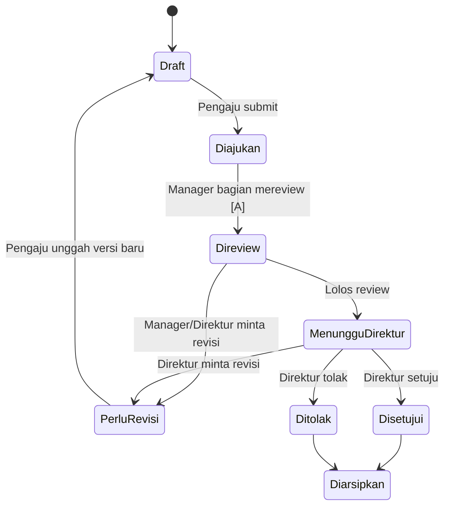
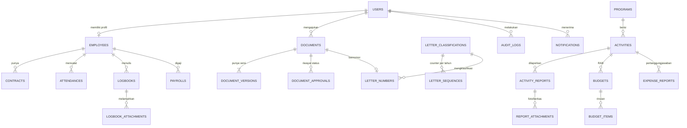

# PRD — Sistem Informasi Terintegrasi Yayasan Sinar Bhakti Husada (YSBH)

| | |
|---|---|
| **Nama kerja produk** | Sistem Informasi Terintegrasi YSBH |
| **Versi / Status** | v0.1 — Draft untuk validasi |
| **Tanggal** | 30 Oktober 2026 |
| **Penulis** | Vinsensius Devando Febrilian (230712320) |
| **Pemilik proses (stakeholder)** | I Kadek Hermanta, Direktur YSBH |
| **Sumber utama** | Proposal Tugas Akhir (revisi 29-10-2026) |

> **Cara membaca dokumen ini.** Kolom/penanda **[P]** = bersumber langsung dari proposal. **[A]** = asumsi atau rekomendasi saya karena proposal belum menentukan; harus divalidasi ke Direktur/HR/Keuangan/Program sebelum diimplementasikan (sesuai bagian 3.2 proposal: Analisis dan Validasi Kebutuhan). Daftar lengkap ada di Bagian 15.

---

## 1. Ringkasan

YSBH adalah yayasan bidang kesehatan yang menjalankan program penanggulangan dan eliminasi malaria di Papua **[P]**. Operasional dijalankan oleh HR, Keuangan, dan Program di bawah Direktur, dengan Staf Lapangan sebagai pelaksana kegiatan **[P]**. Saat ini dokumen dikelola dengan Excel/Word, dikirim bolak-balik lewat WhatsApp, dan absensi/logbook dipantau Direktur lewat Google Drive **[P]**.

Produk ini adalah **aplikasi web internal** yang memusatkan data dan dokumen HR, Keuangan, dan Program dalam satu alur kerja, mengendalikan penomoran surat agar tidak duplikat, dan memberi Direktur akses sesuai peran untuk memantau serta menyetujui **[P]**.

## 2. Masalah, Tujuan, dan Ukuran Keberhasilan

### 2.1 Masalah yang diselesaikan **[P]**

| ID | Masalah (dari Bab I) |
|---|---|
| M1 | Nomor surat duplikat: nomor baru dicatat setelah disetujui Direktur, sementara pengaju hanya bisa menebak nomor berikutnya (spreadsheet dikunci HR). |
| M2 | Satu dokumen beredar dalam banyak versi lewat WhatsApp; versi terbaru sulit dipastikan. |
| M3 | Perubahan dan persetujuan sulit ditelusuri karena terpendam di percakapan. |
| M4 | Dokumen mudah terlewat/terlambat diproses karena pengiriman manual. |
| M5 | Direktur memantau absensi & logbook manual lewat Google Drive dan harus menghimpun informasi dari tiap bagian satu per satu. |
| M6 | Bukti kegiatan Staf Lapangan dikirim terpisah ke Program dan Keuangan. |

### 2.2 Tujuan dan metrik **[P/A]**

| Tujuan | Metrik | Target (usulan **[A]**, perlu disepakati) |
|---|---|---|
| G1. Satu sumber data & alur dokumen terpadu (M2, M3, M4, M6) | Persentase skenario black box fitur inti yang lulus | 100% skenario prioritas *Must* lulus |
| G2. Nomor surat tidak pernah duplikat (M1) | Duplikasi nomor pada uji konkurensi (mis. 50 permintaan paralel) | 0 duplikat |
| G3. Direktur punya gambaran menyeluruh (M5) | Informasi status dokumen, absensi, logbook tersedia di satu dashboard | Semua widget *Must* tersedia dan sesuai data |
| G4. Mudah digunakan oleh pengguna YSBH | Skor SUS rata-rata | ≥ 68 (batas umum "di atas rata-rata"); pembanding di proposal: 76,25 [10] |

---

## 3. Ruang Lingkup

### 3.1 Dalam cakupan **[P]**
- Aplikasi web responsif (komputer & ponsel via browser), hanya untuk internal yayasan.
- 7 peran: Direktur, HR Manager, Staf HR, Finance Manager, Program Manager, Program Officer, Staf Lapangan.
- Autentikasi username + password, RBAC.
- Alur dokumen antar HR–Keuangan–Program–Direktur dengan status & riwayat persetujuan.
- Penomoran surat otomatis bebas duplikat + register nomor surat.
- Absensi, logbook harian, dan ringkasan untuk Direktur.
- Unggah bukti kegiatan (foto/berkas) dengan pembatasan jenis & ukuran dan notifikasi status unggah.
- Pengujian black box + evaluasi SUS.

### 3.2 Di luar cakupan **[P]**
- Aplikasi native Android/iOS; mode offline.
- Tanda tangan digital tersertifikasi (PSrE) — persetujuan hanya berupa status + riwayat.
- Editor dokumen di dalam sistem (edit Word/Excel online).
- 2FA dan enkripsi tingkat berkas.
- Analitik lanjutan (prediksi, penilaian kinerja otomatis).
- Integrasi sistem eksternal (aplikasi akuntansi, WhatsApp).
- Load test, penetration test, pengukuran performa di berbagai kondisi jaringan.

---

## 4. Pengguna dan Hak Akses

### 4.1 Persona ringkas **[P]**

| Peran | Tanggung jawab utama |
|---|---|
| Direktur | Menyetujui dokumen dari HR, Keuangan, Program; memantau absensi & logbook; mengambil keputusan. |
| HR Manager | Kepegawaian, masa kontrak, register nomor surat, absensi. |
| Staf HR | Input/operasional data kepegawaian & surat. |
| Finance Manager | Keuangan: gaji, RAB, pertanggungjawaban keuangan. |
| Program Manager | Perencanaan & pengelolaan program/kegiatan. |
| Program Officer | Menjalankan/mengawal kegiatan program, verifikasi laporan lapangan **[A]**. |
| Staf Lapangan | Melaksanakan kegiatan; melapor dengan foto & berkas ke Program dan Keuangan. |

### 4.2 Matriks hak akses awal **[A]**

Legenda: **R** = lihat, **W** = buat/ubah, **A** = setujui/tolak, **own** = hanya data miliknya, **tim** = data timnya, **–** = tidak ada akses.

| Fitur | Direktur | HR Mgr | Staf HR | Fin Mgr | Prog Mgr | Prog Officer | Staf Lapangan |
|---|---|---|---|---|---|---|---|
| Kelola akun & peran | R | W | – | – | – | – | – |
| Data karyawan & kontrak | R | W | W | R (terbatas) | – | – | own R |
| Absensi | R semua | R semua | R semua | R rekap | R tim | own W | own W |
| Logbook harian | R semua | R semua | own W | own W | own W + R tim | own W | own W |
| Minta nomor surat | R register | W (kelola register) | W | W | W | W | – (lihat Q-07) |
| Dokumen & alur persetujuan | A | W + review | W | W + review | W + review | W | W (laporan) |
| Program & kegiatan | R + A | – | – | R | W | W (ditugaskan) | R (ditugaskan) |
| Laporan kegiatan lapangan (foto/berkas) | R | – | – | R | R + verifikasi | R + verifikasi | own W |
| RAB & pertanggungjawaban keuangan | R + A | – | – | W | R (RAB program) | – | – |
| Gaji & slip | R + A | – | – | W | – | – | own R |
| Dashboard Direktur | R | – | – | – | – | – | – |
| Audit log | R | – | – | – | – | – | – |

> Catatan: dari 7 peran tidak ada **administrator sistem**. Lihat Q-01.

Prinsip **[P]** (landasan RBAC [12]): *least privilege* dan *separation of duties* — mis. pihak yang mengajukan pembayaran ≠ pihak yang menyetujui. Semua pengecekan hak akses wajib di **sisi server**, bukan hanya menyembunyikan menu.

---

## 5. Alur Bisnis To-Be (ringkas)

### 5.1 Alur dokumen & persetujuan **[P/A]**



Aturan: setiap transisi mencatat **siapa, kapan, dari-status → ke-status, komentar** (riwayat tidak bisa diubah). Setiap unggahan ulang membuat **versi baru** (v1, v2, …), versi lama tetap bisa dibuka. Hanya versi terbaru yang bisa diajukan.

### 5.2 Alur penomoran surat **[P/A]**

1. Pengaju membuat surat → sistem **mencadangkan nomor** secara atomik (status `Dicadangkan`) sehingga nomor langsung terlihat di register dan tidak bisa dipilih orang lain.
2. Nomor dilekatkan ke dokumen yang diajukan.
3. Direktur setuju → nomor menjadi `Terbit`.
4. Ditolak / ditarik pengaju → nomor menjadi `Batal` + alasan. **Nomor batal tidak dipakai ulang** (register tetap utuh dan bisa diaudit).

Ini langsung menjawab akar masalah M1: nomor dicatat *sebelum* persetujuan.

### 5.3 Alur laporan kegiatan lapangan **[P/A]**
Staf Lapangan unggah foto/berkas + deskripsi → status unggah ditampilkan (berhasil/gagal/coba lagi) → Program Officer/Manager memverifikasi → Keuangan dapat melihat bukti yang sama sebagai dasar pertanggungjawaban (tidak dikirim dua kali).

---

## 6. Kebutuhan Fungsional

Prioritas MoSCoW: **M** = Must, **S** = Should, **C** = Could.

### 6.1 Autentikasi & RBAC (AUTH)

| ID | Kebutuhan | Prio | Sumber |
|---|---|---|---|
| FR-AUTH-01 | Login dengan username + password. | M | P |
| FR-AUTH-02 | Logout dan sesi kedaluwarsa otomatis saat tidak aktif. | M | A |
| FR-AUTH-03 | RBAC 7 peran, dicek di server untuk setiap route/aksi. | M | P |
| FR-AUTH-04 | Ubah kata sandi sendiri; reset oleh pengelola akun. | M | A |
| FR-AUTH-05 | Akun dapat dinonaktifkan (mis. kontrak berakhir) tanpa menghapus riwayat. | S | A |

**Acceptance (FR-AUTH-03):** *Given* Staf Lapangan login, *when* membuka URL halaman dashboard Direktur secara langsung, *then* sistem menolak (HTTP 403) dan kejadian tercatat di audit log.

### 6.2 Kepegawaian — HR (HR)

| ID | Kebutuhan | Prio | Sumber |
|---|---|---|---|
| FR-HR-01 | CRUD data karyawan (identitas, jabatan, bagian, peran sistem, status). | M | P |
| FR-HR-02 | Kelola kontrak: jenis, tanggal mulai, tanggal berakhir, riwayat kontrak. | M | P |
| FR-HR-03 | Penanda/pengingat kontrak yang mendekati berakhir (ambang mis. 60 hari, bisa diatur). | S | A |
| FR-HR-04 | Unggah berkas kepegawaian (kontrak, KTP, dll.) per karyawan. | S | A |
| FR-HR-05 | Riwayat perubahan data karyawan (siapa mengubah apa). | S | A |

### 6.3 Absensi (ABS)

| ID | Kebutuhan | Prio | Sumber |
|---|---|---|---|
| FR-ABS-01 | Karyawan mencatat absen masuk dan pulang dari browser (ponsel/komputer). | M | P |
| FR-ABS-02 | Rekap absensi harian/bulanan per karyawan dan per bagian dengan filter tanggal. | M | P |
| FR-ABS-03 | Direktur dan HR melihat absensi semua karyawan. | M | P |
| FR-ABS-04 | Status ketidakhadiran (izin/sakit/tugas lapangan) — mekanisme perlu divalidasi. | S | A |
| FR-ABS-05 | Ekspor rekap (CSV/XLSX). | C | A |

### 6.4 Logbook harian (LOG)

| ID | Kebutuhan | Prio | Sumber |
|---|---|---|---|
| FR-LOG-01 | Karyawan mengisi logbook setiap hari kerja (tanggal, uraian aktivitas, lampiran bukti). | M | P |
| FR-LOG-02 | Lampiran bukti pendukung (foto/berkas) pada logbook; wajib atau tidaknya divalidasi. | M | P [11] |
| FR-LOG-03 | Direktur melihat logbook per karyawan/tanggal; Manager melihat logbook timnya. | M | P |
| FR-LOG-04 | Indikator karyawan yang belum mengisi logbook pada hari kerja tertentu. | S | A |
| FR-LOG-05 | Batas waktu ubah/hapus logbook (mis. hanya hari yang sama). | S | A |

### 6.5 Dokumen & alur persetujuan (DOC)

| ID | Kebutuhan | Prio | Sumber |
|---|---|---|---|
| FR-DOC-01 | Unggah dokumen dengan metadata (judul, jenis, bagian pemilik, tanggal, catatan). | M | P |
| FR-DOC-02 | Versi dokumen otomatis; riwayat versi dapat dibuka. | M | P [15] |
| FR-DOC-03 | Pengaju mengajukan dokumen ke alur persetujuan. | M | P |
| FR-DOC-04 | Review/persetujuan: setujui, tolak, atau minta revisi dengan komentar wajib untuk tolak/revisi. | M | P |
| FR-DOC-05 | Riwayat status & persetujuan (siapa, kapan, status, komentar), tidak dapat diubah. | M | P |
| FR-DOC-06 | Daftar dokumen dengan pencarian & filter (jenis, status, bagian, tanggal). | M | P |
| FR-DOC-07 | Pratinjau (PDF/gambar) dan unduh; tipe lain unduh. | M | P |
| FR-DOC-08 | Notifikasi dalam aplikasi saat ada dokumen menunggu aksi atau status berubah. | S | A |
| FR-DOC-09 | Dokumen dapat ditautkan ke kegiatan Program atau RAB. | S | A |

**Acceptance (FR-DOC-02):** *Given* dokumen v1 berstatus Perlu Revisi, *when* pengaju mengunggah file baru, *then* tercipta v2, v1 tetap tersimpan dan bisa dibuka, dan hanya v2 yang bisa diajukan.

### 6.6 Penomoran surat (NOM) — inti penelitian

| ID | Kebutuhan | Prio | Sumber |
|---|---|---|---|
| FR-NOM-01 | Karyawan berwenang meminta nomor surat; nomor dihasilkan sistem, tidak diketik manual. | M | P |
| FR-NOM-02 | Format nomor dapat dikonfigurasi (komponen: nomor urut, kode klasifikasi/bagian, bulan Romawi, tahun). | M | P [7] / A |
| FR-NOM-03 | **Keunikan terjamin saat banyak pengguna meminta bersamaan** (lihat 7.1). | M | P |
| FR-NOM-04 | Nomor dicadangkan saat surat dibuat (sebelum persetujuan Direktur) sehingga langsung tercatat di register. | M | P |
| FR-NOM-05 | Register nomor surat terpusat: nomor, perihal, pembuat, tanggal, status (Dicadangkan/Terbit/Batal), tautan dokumen. | M | P |
| FR-NOM-06 | Pembatalan nomor dengan alasan; nomor batal tidak dipakai ulang. | M | A |
| FR-NOM-07 | Master klasifikasi/kode surat dikelola HR Manager. | S | A |
| FR-NOM-08 | Ekspor register (XLSX/CSV) untuk menggantikan spreadsheet lama; impor nomor historis. | S | A |

**Acceptance (FR-NOM-03):** *Given* 50 permintaan nomor dikirim paralel untuk klasifikasi dan tahun yang sama, *when* semua selesai, *then* terdapat 50 nomor berbeda, berurutan tanpa duplikat, dan tidak ada permintaan yang gagal karena konflik (konflik ditangani retry internal).

### 6.7 Program & laporan kegiatan lapangan (PRG)

| ID | Kebutuhan | Prio | Sumber |
|---|---|---|---|
| FR-PRG-01 | Program Manager membuat dan mengelola program & kegiatan (nama, periode, penanggung jawab, status). | M | P |
| FR-PRG-02 | Penugasan kegiatan ke Program Officer/Staf Lapangan. | M | A |
| FR-PRG-03 | Staf Lapangan membuat laporan kegiatan + unggah foto dan berkas. | M | P |
| FR-PRG-04 | Validasi unggahan: jenis berkas (PDF, JPG/PNG, dokumen perkantoran) dan batas ukuran; pesan jelas bila ditolak. | M | P |
| FR-PRG-05 | Notifikasi status unggah (sedang mengunggah / berhasil / gagal + coba lagi). | M | P |
| FR-PRG-06 | Verifikasi laporan oleh Program Officer/Manager (diterima / perlu perbaikan). | S | A |
| FR-PRG-07 | Laporan dan buktinya dapat dilihat Keuangan tanpa pengiriman ulang. | M | P |
| FR-PRG-08 | Kompresi gambar di sisi klien sebelum unggah untuk jaringan lemah. | S | A |
| FR-PRG-09 | Lokasi teks kegiatan; koordinat GPS otomatis (sebagaimana [10]) — tidak ada di proposal. | C | A |

### 6.8 Keuangan (FIN)

| ID | Kebutuhan | Prio | Sumber |
|---|---|---|---|
| FR-FIN-01 | Finance Manager menyusun RAB per program/kegiatan (item, kuantitas, harga satuan, total). | M | P |
| FR-FIN-02 | RAB diajukan ke Direktur melalui alur persetujuan dokumen (FR-DOC). | M | P |
| FR-FIN-03 | Pertanggungjawaban keuangan: realisasi biaya + bukti, dikaitkan ke kegiatan. | M | P |
| FR-FIN-04 | Pembandingan RAB vs realisasi per kegiatan. | S | A |
| FR-FIN-05 | Data gaji karyawan (komponen & periode) dan slip gaji per karyawan. | S | P (cakupan perlu divalidasi) |
| FR-FIN-06 | Gaji hanya terlihat oleh Finance Manager, Direktur, dan pemilik slip. | M | P (pemisahan HR vs gaji) |

### 6.9 Dashboard Direktur (DSH)

| ID | Kebutuhan | Prio | Sumber |
|---|---|---|---|
| FR-DSH-01 | Antrean dokumen menunggu persetujuan, dapat langsung disetujui dari sana. | M | P |
| FR-DSH-02 | Ringkasan status dokumen (jumlah per status & per bagian). | M | P |
| FR-DSH-03 | Ringkasan absensi hari ini (hadir/tidak/belum absen). | M | P |
| FR-DSH-04 | Ringkasan logbook (sudah/belum mengisi) dengan drill-down ke isi. | M | P |
| FR-DSH-05 | Ringkasan kegiatan Program (berjalan/selesai) dan laporan lapangan terbaru. | S | A |
| FR-DSH-06 | Peringatan kontrak karyawan yang akan berakhir. | S | A |

### 6.10 Jejak audit (AUD)

| ID | Kebutuhan | Prio | Sumber |
|---|---|---|---|
| FR-AUD-01 | Mencatat aksi penting: login, perubahan data, transisi status dokumen, nomor surat, akses ditolak. | M | P |
| FR-AUD-02 | Log tidak dapat diubah/dihapus dari antarmuka aplikasi. | M | A |
| FR-AUD-03 | Direktur dapat menelusuri log dengan filter pengguna/tanggal/aksi. | S | A |

---

## 7. Aturan Teknis Kunci

### 7.1 Keunikan nomor surat (berlapis)

1. **Counter terpusat** per `(klasifikasi, tahun)` di tabel `letter_sequences`.
2. **Transaksi + kunci baris**: dalam satu transaksi database, kunci baris counter (`SELECT … FOR UPDATE` / `lockForUpdate()` di Laravel), naikkan `last_number`, buat record `letter_numbers`, commit. Permintaan bersamaan antre di baris yang sama sehingga terurut.
3. **Unique constraint** di database pada kolom `full_number` (dan `(classification_id, year, sequence)`) sebagai pengaman terakhir bila logika aplikasi bocor.
4. **Retry** terbatas bila terjadi deadlock/serialization failure; pengguna tidak melihat error.
5. Nomor **tidak dipakai ulang** setelah `Batal`.

Contoh format (hanya ilustrasi **[A]**, format asli harus dari HR): `{seq:3}/YSBH/{kode}/{bulan_romawi}/{tahun}` → `014/YSBH/HR/X/2026`.

### 7.2 Unggah berkas **[P/A]**
- Jenis diizinkan: PDF, JPG/PNG, dokumen perkantoran (docx/xlsx/pptx) **[P]**.
- Batas ukuran: usulan 10 MB dokumen, 5 MB gambar (setelah kompresi) **[A]**.
- Validasi di klien **dan** server (cek MIME & ekstensi), nama file diacak di penyimpanan, akses unduh lewat route ber-otorisasi (bukan URL publik).
- Antarmuka menunjukkan progres dan hasil unggah; unggahan gagal bisa diulang tanpa mengisi ulang formulir.

### 7.3 Status & riwayat
- Status dokumen disimpan sebagai *state machine* di satu tempat (service/enum); setiap transisi yang tidak valid ditolak.
- Riwayat disimpan di tabel terpisah *append-only*.

---

## 8. Kebutuhan Non-Fungsional

| ID | Kebutuhan | Sumber |
|---|---|---|
| NFR-01 | **Responsif**: semua halaman dapat dipakai di layar ponsel; alur Staf Lapangan (absen, logbook, laporan) dirancang *mobile-first*. | P |
| NFR-02 | **Keamanan**: kata sandi di-hash (bcrypt/argon2), proteksi CSRF/XSS/SQL injection (bawaan framework), HTTPS, otorisasi server-side. | P/A |
| NFR-03 | **Usability**: tugas utama dapat diselesaikan tanpa pelatihan panjang; dievaluasi dengan SUS. | P |
| NFR-04 | **Auditabilitas**: seluruh aksi kritis tercatat (FR-AUD). | P |
| NFR-05 | **Integritas data**: foreign key, unique constraint, dan normalisasi di basis data terpusat [17], [18]. | P |
| NFR-06 | **Ketersediaan data**: backup basis data & berkas terjadwal; prosedur restore diuji sekali. | A |
| NFR-07 | **Toleransi jaringan lemah** (tanpa offline): ukuran halaman ringan, kompresi gambar, pesan error jelas, retry unggah. | P (sebatas sisi aplikasi) |
| NFR-08 | **Kompatibilitas**: dua versi terakhir Chrome/Edge/Firefox/Safari; Chrome Android. | A |
| NFR-09 | **Bahasa**: antarmuka Bahasa Indonesia; zona waktu per pengguna/organisasi perlu ditetapkan (Papua = WIT, kantor lain mungkin WIB). | A |

---

## 9. Model Data (awal)



Catatan desain:
- `roles`/`permissions` memakai paket RBAC (mis. Spatie Laravel Permission yang dipakai pada [9]).
- `document_approvals` dan `audit_logs` bersifat **append-only**.
- `letter_numbers` punya unique index pada `full_number` dan pada `(classification_id, year, sequence)`; kolom `status` ∈ {`reserved`, `issued`, `void`}, `void_reason`.
- `document_versions` menyimpan path berkas, ukuran, MIME, hash (opsional), `version_no`, `uploaded_by`.
- Gunakan *soft delete* untuk entitas bisnis; jangan hapus fisik data yang punya riwayat.

---

## 10. Arsitektur & Teknologi **[A — rekomendasi]**

Proposal (Tabel 3.1) baru mencantumkan Figma dan Git/GitHub/GitLab; pilihan teknologi inti belum ditetapkan, namun pustaka yang dikaji dominan memakai Laravel [4], [5], [6], [9], [19]. Rekomendasi agar selaras dengan pustaka dan cocok untuk skala TA S1:

| Lapisan | Rekomendasi | Alasan |
|---|---|---|
| Backend | **Laravel 12** (PHP 8.3), pola MVC | Terdokumentasi, RBAC & validasi & queue siap pakai, sejalan dengan pustaka [4], [9]. |
| Frontend | Blade + **Tailwind CSS** + Alpine.js (atau Livewire) | Satu repo, responsif, cepat dibuat; selaras [4], [9]. Hindari SPA terpisah agar pengembangan sederhana. |
| Basis data | **MySQL** (disukai) atau MySQL | Keduanya mendukung kunci baris & unique constraint untuk G2. |
| RBAC | spatie/laravel-permission | Sama seperti [9]. |
| Penyimpanan berkas | Disk privat Laravel (lokal/S3-compatible) | Akses via route ber-otorisasi. |
| Antrean (opsional) | Database queue | Pemrosesan thumbnail/notifikasi tanpa infrastruktur tambahan. |
| Pengujian | Pest/PHPUnit (feature test + uji konkurensi nomor surat), Laravel Dusk/Playwright untuk alur utama | Test otomatis dapat menjadi bukti black box. |
| Kolaborasi | Git + GitHub/GitLab, branch per fitur, CI menjalankan test | Sesuai Tabel 3.1. |
| Deploy | VPS/hosting dengan HTTPS, backup harian | Sumber daya sederhana **[A]**; perlu konfirmasi apakah YSBH punya server. |

Struktur modul yang disarankan (satu aplikasi monolit modular):

```
app/
  Domain/
    Auth/  Hr/  Attendance/  Logbook/
    Documents/    # state machine, versioning, approvals
    Letters/      # LetterNumberService (transaksi + lock)
    Programs/  Finance/  Dashboard/  Audit/
resources/views/<modul>/...
tests/Feature/<modul>/...
```

---

## 11. UI/UX

### 11.1 Status referensi Figma
Tautan Figma yang diberikan (`…/cuWkafn9O3vbTN8qeQUcQL/Untitled?node-id=0-1`) **belum dapat saya baca** karena Figma memblokir akses otomatis. Karena itu bagian ini berisi *inventaris layar* dari proposal; kolom "Frame Figma" diisi setelah desainnya bisa saya lihat (lewat konektor Figma atau ekspor gambar/PNG & daftar nama frame). Node `0-1` hanya menunjuk halaman kanvas paling atas, bukan frame spesifik — sebaiknya sertakan link per frame (klik kanan frame → *Copy link to selection*).

### 11.2 Peta situs & inventaris layar

| # | Layar | Peran utama | Modul | Frame Figma |
|---|---|---|---|---|
| S01 | Login | Semua | AUTH | _isi_ |
| S02 | Dashboard Direktur | Direktur | DSH | _isi_ |
| S03 | Beranda per peran (ringkasan tugas, notifikasi) | Selain Direktur | DSH | _isi_ |
| S04 | Daftar karyawan | HR | HR | _isi_ |
| S05 | Form/detail karyawan + kontrak | HR | HR | _isi_ |
| S06 | Absensi saya (absen masuk/pulang) | Semua | ABS | _isi_ |
| S07 | Rekap absensi | Direktur, HR, Manager | ABS | _isi_ |
| S08 | Logbook saya (daftar + form) | Semua | LOG | _isi_ |
| S09 | Logbook tim/karyawan (monitoring) | Direktur, Manager | LOG | _isi_ |
| S10 | Daftar dokumen (filter status/jenis) | Semua | DOC | _isi_ |
| S11 | Unggah/ajukan dokumen | Pengaju | DOC | _isi_ |
| S12 | Detail dokumen: pratinjau, versi, riwayat, aksi setuju/tolak/revisi | Semua sesuai hak | DOC | _isi_ |
| S13 | Antrean persetujuan | Direktur, Manager | DOC | _isi_ |
| S14 | Permintaan nomor surat | Pengaju | NOM | _isi_ |
| S15 | Register nomor surat | HR, Direktur | NOM | _isi_ |
| S16 | Master klasifikasi surat | HR Manager | NOM | _isi_ |
| S17 | Daftar program & kegiatan | Program | PRG | _isi_ |
| S18 | Detail kegiatan + laporan lapangan | Program, Keuangan | PRG | _isi_ |
| S19 | Buat laporan kegiatan (foto/berkas, status unggah) | Staf Lapangan | PRG | _isi_ |
| S20 | RAB (daftar, form) | Keuangan, Direktur | FIN | _isi_ |
| S21 | Pertanggungjawaban keuangan | Keuangan | FIN | _isi_ |
| S22 | Gaji & slip | Keuangan, Direktur, pemilik | FIN | _isi_ |
| S23 | Notifikasi | Semua | DOC | _isi_ |
| S24 | Audit log | Direktur | AUD | _isi_ |
| S25 | Kelola akun & peran | HR Manager | AUTH | _isi_ |

### 11.3 Panduan UI yang harus dipenuhi desain
- Navigasi sisi (desktop) berubah menjadi bottom-nav/hamburger di ponsel; menu hanya menampilkan fitur yang boleh diakses peran.
- Badge status dokumen konsisten (Draft, Diajukan, Direview, Menunggu Direktur, Perlu Revisi, Disetujui, Ditolak, Diarsipkan) dan **tidak bergantung pada warna saja**.
- Alur Staf Lapangan: tombol besar, formulir pendek, progres unggah terlihat, pesan error bisa ditindaklanjuti.
- Tabel lebar bisa digulir horizontal di ponsel atau berubah menjadi kartu.
- Keadaan *empty*, *loading*, *error*, dan *sukses* didesain untuk tiap layar utama.

---

## 12. Rencana Implementasi Bertahap ("Nyicil")

Prinsip: **irisan vertikal** (tiap fase menghasilkan fitur yang bisa dicoba dari UI sampai database), tiap fase ditutup dengan test dan tag rilis. Fase 0–1 aman dimulai sekarang karena kecil kemungkinan berubah setelah validasi kebutuhan; fase 2–3 adalah inti penelitian sehingga didahulukan.

| Fase | Isi | Definition of Done | Perkiraan jadwal (selaras Tabel 3.3) |
|---|---|---|---|
| **0. Fondasi** | Repo + Git flow, Laravel, DB, layout dasar Tailwind (mengikuti Figma), CI test, seeder 7 peran, login/logout, middleware RBAC, audit log dasar (FR-AUTH-01–04, FR-AUD-01) | Login per peran; akses terlarang → 403; CI hijau | Akhir Bulan 1 (paralel dengan perancangan) |
| **1. Kepegawaian** | Data karyawan, kontrak, kelola akun (FR-HR-01–02, S04–S05, S25) | HR dapat membuat karyawan + akun + kontrak; peran lain dibatasi | Bulan 2 minggu 1 |
| **2. Penomoran surat** | Klasifikasi, `LetterNumberService`, register, batal nomor (FR-NOM-01–06) | **Uji konkurensi 50 permintaan paralel = 0 duplikat** (otomatis); register tampil | Bulan 2 minggu 2 |
| **3. Dokumen & persetujuan** | Unggah, versi, state machine, review/setuju/tolak/revisi, riwayat, daftar+filter, notifikasi, integrasi dengan nomor surat (FR-DOC-01–08) | Alur HR→Manager→Direktur selesai end-to-end dengan riwayat lengkap | Bulan 2 minggu 3–4 |
| **4. Program & laporan lapangan** | Program/kegiatan, penugasan, laporan + unggah foto/berkas, validasi & status unggah, verifikasi (FR-PRG-*) | Staf Lapangan unggah dari ponsel; Program & Keuangan melihat bukti yang sama | Bulan 3 minggu 1 |
| **5. Keuangan** | RAB (memakai alur DOC), pertanggungjawaban, RAB vs realisasi; gaji bila lolos validasi (FR-FIN-*) | RAB diajukan & disetujui Direktur; pertanggungjawaban terkait kegiatan | Bulan 3 minggu 2 |
| **6. Absensi & logbook** | Absen masuk/pulang, rekap, logbook + lampiran, indikator belum isi (FR-ABS-*, FR-LOG-*) | Direktur melihat absensi & logbook semua karyawan | Bulan 3 minggu 2–3 |
| **7. Dashboard Direktur** | Widget antrean, status dokumen, absensi, logbook, kegiatan (FR-DSH-*) | Angka dashboard cocok dengan data sumber | Bulan 3 minggu 3 |
| **8. Hardening & evaluasi** | Perbaikan bug, uji hak akses menyeluruh, black box formal, SUS, dokumentasi | Semua skenario *Must* lulus; SUS terkumpul | Bulan 3 akhir – Bulan 4 |

Tips agar bisa dicicil:
- Satu fitur = satu branch + satu PR kecil; tulis test bersamaan dengan fiturnya (test ini kelak jadi bukti black box).
- Buat **data seeder realistis** (7 pengguna, beberapa dokumen, nomor surat) supaya demo ke Direktur tidak kosong.
- Rilis internal tiap akhir fase (staging) dan minta umpan balik singkat dari satu perwakilan peran terkait.
- Tunda yang berstatus *Should/Could* (GPS, ekspor, gaji) sampai *Must* tuntas.

---

## 13. Rencana Pengujian **[P/A]**

| Aspek | Metode | Instrumen | Kriteria keberhasilan |
|---|---|---|---|
| Fungsionalitas | Black box per requirement *Must*; tiap FR → ≥ 1 skenario (positif & negatif) | Tabel skenario (ID, langkah, hasil diharapkan, pass/fail) | 100% skenario *Must* lulus; defect kritis = 0 |
| Kontrol akses | Matriks peran × aksi (izinkan/tolak) | Jumlah skenario sesuai/total | 100% sesuai matriks Bagian 4.2 |
| Keunikan nomor surat | Uji paralel otomatis + uji manual 2 pengguna | Jumlah duplikat | 0 duplikat |
| Unggah berkas | Jenis/ukuran valid & tidak valid, unggah gagal-ulang | Pass/fail | Sesuai FR-PRG-04/05 |
| Usability | SUS 10 butir pada pengguna YSBH (semua peran terwakili) + uji tugas | Skor SUS rata-rata, keberhasilan tugas | ≥ 68 (usulan), dasar: konvensi SUS; pembanding [10] |

Di luar cakupan: load test, penetration test, uji berbagai kondisi jaringan **[P]**.

---

## 14. Risiko

| Risiko | Dampak | Mitigasi |
|---|---|---|
| Kebutuhan berubah setelah validasi (alur approval, format nomor) | Rework | Alur & format dibuat **konfigurasi/state machine terpusat**; validasi kebutuhan lebih awal (Q-01–Q-10). |
| Ketersediaan stakeholder (Direktur, HR, Keuangan, Staf Lapangan di Papua) terbatas | Validasi & SUS terlambat | Jadwalkan sesi singkat; demo berkala; SUS bisa diisi daring. |
| Jaringan Staf Lapangan lemah | Unggah gagal, UX buruk | Kompresi gambar, batas ukuran, retry, status jelas (sesuai batasan proposal). |
| Cakupan keuangan melebar (penggajian kompleks) | Waktu habis | Gaji = *Should*; mulai dari data & slip sederhana, tanpa kalkulasi pajak/BPJS kecuali diminta. |
| Data sensitif (gaji, kepegawaian) | Kebocoran | RBAC ketat, akses berkas via route ber-otorisasi, audit log, HTTPS. |
| Migrasi data lama (Excel/WhatsApp) | Data historis tidak ada | Impor nomor surat & data karyawan via CSV; dokumen lama tidak wajib dimigrasi. |
| Tidak ada infrastruktur hosting | Tidak bisa dipakai nyata | Tentukan hosting sejak Bulan 1; fallback: demo di staging. |

---

## 15. Asumsi dan Pertanyaan Terbuka (untuk validasi)

| ID | Pertanyaan | Ditujukan ke | Dampak jika berbeda |
|---|---|---|---|
| Q-01 | Siapa **administrator sistem**? (HR Manager atau akun teknis di luar 7 peran) | Direktur | Fitur kelola akun, S25 |
| Q-02 | Rantai persetujuan: apakah Staf → Manager → Direktur, atau langsung ke Direktur? Apakah berbeda per jenis dokumen (surat, RAB, pertanggungjawaban, laporan)? | Direktur, Manager | State machine & dashboard |
| Q-03 | Format nomor surat yang berlaku, dan apakah counter per klasifikasi/tahun atau satu urutan global? | HR | `LetterNumberService`, master klasifikasi |
| Q-04 | Apakah nomor boleh dicadangkan sebelum persetujuan (rekomendasi) atau baru diberikan setelah disetujui? | Direktur, HR | Alur 5.2 |
| Q-05 | Mekanisme absensi: tombol masuk/pulang saja, perlu foto/lokasi, bagaimana izin/sakit/tugas lapangan? | HR, Direktur | FR-ABS-* |
| Q-06 | Logbook: lampiran wajib? batas waktu pengisian? apakah Staf Lapangan juga mengisi logbook atau cukup laporan kegiatan? | Direktur | FR-LOG-*, FR-PRG-* |
| Q-07 | Apakah Staf Lapangan boleh meminta nomor surat? | HR | Matriks 4.2 |
| Q-08 | Cakupan gaji: sebatas data & slip, atau kalkulasi komponen/potongan? | Finance Manager | FR-FIN-05, risiko cakupan |
| Q-09 | Batas ukuran berkas & jenis yang diizinkan secara pasti; apakah ada video? | Program, Keuangan | Penyimpanan, NFR-07 |
| Q-10 | Pembagian zona waktu (WIB/WIT) dan jam kerja resmi | HR | Absensi, laporan "belum mengisi" |
| Q-11 | Tempat hosting/server yang tersedia dan kebijakan backup | Direktur | Deploy |
| Q-12 | Apakah data karyawan/nomor surat historis akan diimpor? | HR | FR-NOM-08, FR-HR |

---

## 16. Keterlacakan (Masalah → Tujuan → Requirement → Pengujian)

| Masalah | Tujuan | Requirement | Pengujian |
|---|---|---|---|
| M1 | G2 | FR-NOM-01–06 | Uji konkurensi, skenario register |
| M2 | G1 | FR-DOC-01, 02, 06, 07 | Black box DOC |
| M3 | G1 | FR-DOC-04, 05; FR-AUD-* | Black box DOC, AUD |
| M4 | G1 | FR-DOC-08; FR-DSH-01 | Black box DOC/DSH |
| M5 | G3 | FR-ABS-02/03, FR-LOG-03, FR-DSH-* | Black box ABS/LOG/DSH |
| M6 | G1 | FR-PRG-03–05, 07 | Black box PRG |
| (semua) | G4 | NFR-01, 03 | SUS |

---

## 17. Catatan Terhadap Proposal (untuk Bab III)
Bab III di proposal masih berupa template. Isi PRD ini dapat dipakai sebagai bahan: **3.2** ← Bagian 6, 8, 15; **3.3** ← Bagian 5, 7, 9, 11; **3.4** ← Bagian 10, 12; **3.5** ← Bagian 13; **3.6** ← Bagian 14. Pastikan juga Tabel 3.2 (Rencana Pengujian) diganti dengan skenario yang sesuai YSBH (bukan contoh Capstone) dan baris contoh "Sumber A/B" pada Tabel 2.1 dihapus.
